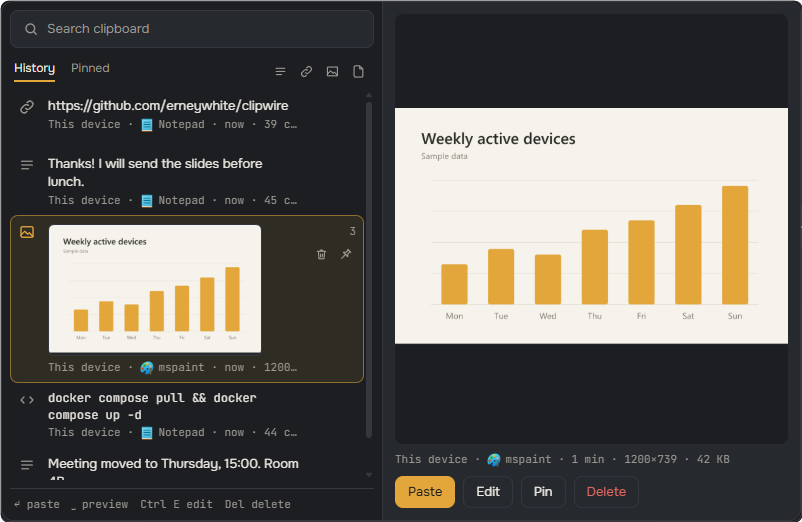
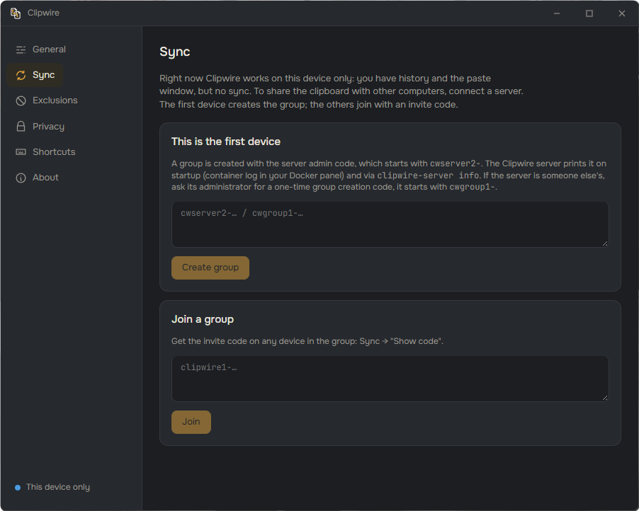
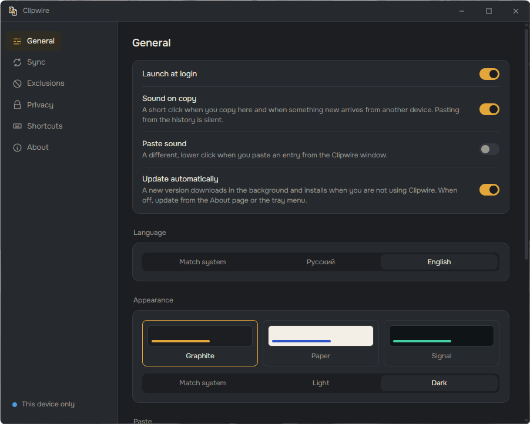

<p align="center">
  
</p>

<h1 align="center">Clipwire</h1>

<p align="center">
  <b>A shared clipboard for your computers, through your own server</b><br>
  <i>Copy here, paste there.</i>
</p>

<p align="center">
  <a href="https://github.com/erneywhite/clipwire/actions/workflows/ci.yml"></a>
  <a href="https://github.com/erneywhite/clipwire/releases/latest"></a>
  <a href="LICENSE"></a>
  <a href="https://ko-fi.com/erneywhite"></a>
</p>

<p align="center">
  <b>English</b> · <a href="README.ru.md">Русский</a>
</p>

<p align="center">
  
</p>

Clipwire is a free shared clipboard. Copy something on one computer, paste it on another.
Text with formatting, images, files and folders travel through a server you run yourself,
and everything is end-to-end encrypted: the server only ever sees ciphertext, and the key
lives on your devices.

The server is a single Docker container. The client keeps a searchable, encrypted history and
a small paste window that opens next to the mouse cursor. Without a server the client still
works as a local clipboard history on one computer, and you can connect a server later.

There are clients for Windows, macOS (13 Ventura or newer, Apple Silicon and Intel) and Linux
(x86-64; X11 and Wayland: GNOME, KDE Plasma, Sway, Hyprland and others).

Found a bug or have an idea? Tell about it in [Issues](https://github.com/erneywhite/clipwire/issues).

## Contents

- [Getting started](#getting-started)
- [Paste window](#paste-window)
- [What gets synced](#what-gets-synced)
- [Image editor](#image-editor)
- [Devices and groups](#devices-and-groups)
- [File storage (S3 / SFTP)](#file-storage-s3--sftp)
- [Privacy and security](#privacy-and-security)
- [Updates](#updates)
- [Settings](#settings)
- [Self-hosted server](#self-hosted-server)
- [Building from source and tests](#building-from-source-and-tests)
- [Project layout](#project-layout)
- [Support](#support)
- [License](#license)

## Getting started

<p align="center">
  
</p>

**Windows.**

1. Download `Clipwire_*_windows_x64-setup.exe` from [Releases](https://github.com/erneywhite/clipwire/releases)
   and run it. It installs for the current user and does not need administrator rights.
2. Start Clipwire. It lives in the tray; press Ctrl+Shift+V to open the paste window.

**macOS.**

1. Download `Clipwire_*_macos_universal.dmg` from [Releases](https://github.com/erneywhite/clipwire/releases),
   open it and drag Clipwire to Applications.
2. The first launch. Clipwire is not notarized by Apple (that needs a paid developer account), so
   macOS says it cannot check the app for malware. Open Clipwire once, close the warning, then go to
   System Settings → Privacy & Security and click **Open Anyway** next to the line about Clipwire.
   Or run once in Terminal: `xattr -dr com.apple.quarantine /Applications/Clipwire.app`.
   This is needed only once: updates are installed by Clipwire itself.
3. Clipwire lives in the menu bar (there is no Dock icon); press Cmd+Shift+V to open the paste window.
4. To paste right into the window you were in, Clipwire needs the **Accessibility** permission. On the
   first paste it explains how to give it and opens the right page of System Settings; until then the
   chosen entry is just put on the clipboard. Updates keep the permission: every version is signed
   with the same certificate.

**Linux.**

1. Download from [Releases](https://github.com/erneywhite/clipwire/releases):
   - Ubuntu, Debian, Linux Mint, Pop!_OS: `Clipwire_*_linux_amd64.deb`, then
     `sudo apt install ./Clipwire_*_linux_amd64.deb`;
   - any other distribution: `Clipwire_*_linux_amd64.AppImage`, then
     `chmod +x Clipwire_*_linux_amd64.AppImage` and run it.
2. Start Clipwire from the application menu. It lives in the tray; press Ctrl+Alt+V to open the
   paste window (on Linux Ctrl+Shift+V is how terminals paste, so the default is different).
3. **Tray icon in GNOME.** Ubuntu shows tray icons out of the box. On other GNOME distributions
   (Fedora, Debian) install the [AppIndicator and KStatusNotifierItem Support](https://extensions.gnome.org/extension/615/appindicator-support/)
   extension, otherwise the icon is not shown (Clipwire still works: open it from the menu).
4. **Wayland.** On GNOME and KDE Plasma the paste window opens next to the tray, elsewhere in the
   middle of the screen. To have it paste by itself,
   turn on **Paste into the active window**; the system asks once for permission, see
   [Paste window](#paste-window). The shortcut is registered with the desktop by itself on GNOME,
   KDE Plasma and Hyprland; on Sway bind `clipwire --popup` to a key yourself.
5. Keys are kept in the system password store (GNOME Keyring, KWallet).

**Without a server.** History and the paste window work on a single computer. You can connect
a server at any time: the last 50 entries of the local history go to the group, and the group's
history is merged into the local one. The clipboard itself is not touched.

**Connecting a server.** Set up the server first (see [Self-hosted server](#self-hosted-server)); it
prints a server code that looks like `cwserver2-…`. That is the administrator's code: groups are
created with it (see [Administrator code](#administrator-code)). If the server belongs to someone else,
its administrator can issue you a one-time group creation code `cwgroup1-…` (see
[Group creation codes](#group-creation-codes)); you enter it in the same place as the server code.

1. On the first device open **Sync**, enter the server code `cwserver2-…` and create a group.
   The device becomes the group admin and the server administrator: a **Server** section appears
   in settings. An old `cwserver1-…` code cannot create a group; the app tells you where to get
   the new one.
2. Clipwire shows an invitation code, `clipwire1-…`. Enter it on your other devices.

The invitation code contains the group's encryption key. Share it only with yourself.

**Moving from Paste (macOS).** The history of [Paste](https://pasteapp.io) can be moved with a
command-line tool for now; a button in Settings is planned. Text and formatted text are moved with
their dates and source apps, pinboard entries become pinned and their titles become notes. A
repeated run pins and labels entries that were moved before; in a group the pins reach the other
devices the next time Clipwire starts. Files are skipped (Paste keeps only
links to them); images are moved with `--images`. Quit Clipwire, set history retention to
"forever", then run from the repository:

```
cargo run --release -p clipwire-agent -- import-paste --dry-run   # only count
cargo run --release -p clipwire-agent -- import-paste --send      # move and send to the group
```

macOS asks once for access to the Clipwire key in the Keychain. Running it again skips what was
already moved.

With `--send` the moved entries also go to the group. Keep your other devices online for the whole
time: the server keeps only the latest entries of a group (50 by default, `CLIPWIRE_HISTORY_LEN`),
and old Paste entries don't make it into that history, so a device that is offline won't get them
later. Entries go out in batches so the receivers keep up: text is quick, images take about 1 MB/s,
and an archive of a few gigabytes takes hours. The tool prints its progress every hundred entries.
If the connection drops, it reconnects and continues from the last entry the server confirmed. If
there is no connection for longer than `--wait` minutes (10 by default), it exits with code 2 and
prints the command that sends the rest, for example:

```
cargo run --release -p clipwire-agent -- import-paste --resend --images --since 1731700000000
```

`--resend` sends entries already moved from Paste to the group without touching the history; it
finds them by their copy time. `--since` takes a date (`YYYY-MM-DD`) or the milliseconds from the
hint, `--skip N` skips the N oldest entries, `--limit N` caps the count. Sending something twice is
harmless: receivers drop entries they already have.

## Paste window

Press Ctrl+Shift+V on Windows, Cmd+Shift+V on macOS or Ctrl+Alt+V on Linux (configurable; on Linux
Ctrl+Shift+V is how terminals paste). The window opens next to the mouse cursor.

On Linux in an Xorg session it works the same way; in terminals it pastes with Ctrl+Shift+V. On Wayland apps can't see the mouse cursor or
press keys in other windows. On GNOME and KDE Plasma the window opens in the corner next to the
panel, on the tray side (Clipwire runs its windows through XWayland there, so it can choose where
they go; set `CLIPWIRE_NATIVE_WAYLAND=1` to keep native Wayland windows). On other Wayland desktops
it opens in the middle of the screen. Enter only puts the entry on the clipboard; you paste it with Ctrl+V
yourself.

**Pasting by itself on Wayland.** Turn on **Paste into the active window** under Paste. The
system then asks once for permission to *control the keyboard* (GNOME calls it "remote desktop" or
"remote control"). It sounds scarier than it is: this is the standard desktop portal that remote
access apps use, and it is the only way Wayland lets an app press a key. Clipwire uses it for
exactly one thing — pressing Ctrl+V right after you pick an entry. It does not see your screen,
does not read what you type and does nothing in the background. While Clipwire is pasting, GNOME
shows a remote-control icon in the top bar; it goes away a minute after the last paste. The
permission is remembered; turn the switch off to revoke it (Clipwire forgets it as well). On Wayland
Clipwire can't tell which window is active, so it always presses Ctrl+V; terminals paste with
Ctrl+Shift+V, so there press it yourself (the entry is already on the clipboard). An app's own shortcut doesn't reach
other apps' windows there, so Clipwire registers it with the desktop and keeps it in sync with its
settings: on GNOME among the custom keyboard shortcuts, on KDE Plasma in the KDE shortcut service
(System Settings → Shortcuts → Clipwire), on Hyprland and other desktops with the global shortcuts
portal (the desktop may ask to confirm once). On Sway, which has none of these, bind
`clipwire --popup` to a key in its config.

| Keys | Action |
|---|---|
| Up, Down, mouse | select |
| Enter, double click | paste where the text cursor is (and send to your other devices) |
| Shift+Enter | paste without formatting |
| Ctrl+1…9 | paste the entry with that number |
| Space | preview (when the search field is empty) |
| Ctrl+P, click the pin on the right of a row | pin or unpin |
| Ctrl+R | add or edit the note of a pinned entry (Enter saves, Esc cancels) |
| Ctrl+E | edit an image |
| Delete (with an empty search), Shift+Delete, the bin icon in a row | delete from history; on a pinned entry, first a choice of what to do |
| Right click, Menu key, Shift+F10 | entry menu: paste, preview, edit, pin, note, delete |
| Tab | switch between History and Pinned |
| Alt+Left, Alt+Right, the icons next to the tabs | filter: text, links, images, files |
| Typing | search |

In the preview you can fix text before pasting: Ctrl+Enter pastes the edited version,
Ctrl+S saves it to the history.

The list scrolls through the whole history, with search and filters too: older entries load in
advance, about 50 entries before you reach the end. A new entry arriving at the top does not
reset what is already loaded or where you are.

Search looks at the first 8 KB of each text, at the notes of pinned entries, file names, the
device and the source app; a
match further into a very long text is not found. The history is read from disk page by page, so
memory use does not grow with it (details in `docs/history-storage.md`).

**Deleting.** By default a deleted entry disappears only on this device. Turn on
**Delete on all devices** under Sync and the deletion is sent to the rest of the group as well.
Devices that are switched off apply it when they connect, within the server's retention period.
Entries pinned on another device are not deleted. The server does not know what was deleted: the
deletion note is encrypted with the group key. This needs server 0.1.3 or newer.

**Pins and notes.** Pinned entries are the same on every device of the group, including devices
that joined later or were off for a long time. A pinned entry can have a note of up to 80
characters, and search looks at it too. Unpinning removes the pin everywhere and erases the note;
the entry stays in the history as an ordinary one. Pinning, unpinning and notes work offline as
well: the change waits on disk and is sent after the device connects. On its first connection to
a server with pins a device uploads its earlier pins once. If two devices pinned the same thing
while offline, one pin is kept with the note of the newer change. A pin can be removed on this
device only: the other devices keep it, and it does not come back here unless you pin it here
again. The server keeps pins with no expiry, encrypted with the group key, and refuses new ones
over its limits (`CLIPWIRE_PIN_MAX`, `CLIPWIRE_PIN_BYTES`): such an entry stays pinned on this
device only, and the app says so. The order of changes is decided by the server, not by device
clocks: an unpin or a note made offline reaches every device even if this device's clock is
behind. Simply deleting a pinned entry removes the pin on this device only; the other devices keep it
pinned. Pinning again and importing from Paste again do not change an existing note: only
editing the note does.

Files in pinned entries. Files under the upload limit are kept in the group storage (the server
or external S3/SFTP) and are not deleted after the retention period while the pin exists.
Folders and files over the limit are not uploaded: other devices see the file card and can fetch
the file directly only while the source device is online. External storage is cleaned by the
devices themselves, using the list of pinned files the server provides. Devices with an older
Clipwire (before pins) do not know this list and may delete pinned files from S3/SFTP after the
retention period, so update the app on every device of the group.

On a group key change the device that changes the key moves the pins to the new group and tells
you if the server refused some of them (the pin limit). Files of pinned entries are not moved:
the server and external storage delete the files of the old group, so in the new group such a
pin keeps the file card, and the file itself is only where it lies on disk. A device that was off
during the key change does not upload pins that other devices removed in the meantime. If the
server database was lost or restored from an old backup, devices notice it, fetch the pins from
the start and upload their live pins again.

This needs a server with protocol `clipwire/8`: the app does not sync with an older server and
asks you to update the image.

A note is shown as the row's title in the theme's accent colour, with the usual content under it:
the text, the image or the file name. Pasting pastes the entry, never the note. To add or change a
note press Ctrl+R (Cmd+R on macOS) or pick **Edit note…** in the entry menu: a field opens in place
of the title, Enter saves, Esc cancels, and an empty field removes the note. In the preview the
note sits at the top, and clicking it opens the same field.

Delete, the bin icon or **Delete** on a pinned entry first asks what to do: **Unpin on this device
only**, **Unpin everywhere** (the entry stays in the history) or **Delete everywhere**. Pick with
the arrow keys and Enter or with the mouse; Esc closes the choice. Ordinary entries are deleted
right away, as before. How many pins the server holds and how much space they take is shown in
About → Status, in the **Pins on the server** row.

## What gets synced

Without a connection the latest copy waits and goes out as soon as the server is reachable. If
Clipwire is closed or the computer shuts down before that, the copy is sent on the next start
(text, formatted text and images; files copied offline stay on this device).

### Text and formatting

Copying from a browser, Word or a mail client keeps HTML and RTF along with the text. Pasting
inserts the formatted version; Shift+Enter (or the plain-text button in the preview) inserts just
the text, and a setting can make that the default. Such entries are marked `HTML` or `RTF` in the
list. The preview renders them in an isolated frame: scripts do not run and external images and
fonts are not loaded, so opening a message does not tell the sender that you read it. If the
formatted text is too big to send, the other devices receive it as plain text.

### Images

A copied image (a screenshot, a picture from a browser or an editor) is sent to your other
devices as lossless PNG and shown as a large thumbnail with its size and weight. Space opens it
in full. If the clipboard holds both text and an image (Excel and some editors do this), the
text is synced. Images over about 7.5 MB as PNG are not sent; the server limit for one item is
8 MiB by default.

An image can be pasted into a folder as a file. If the paste window was opened over File
Explorer (or the desktop), Finder or a Linux file manager (Nautilus, Dolphin, Nemo, Thunar, Caja,
PCManFM), Clipwire puts a file named "Image 2026-11-16 14-05-09.png" on the clipboard instead of
the image. The file lives in Clipwire's temporary folder and is removed after a day; the history
entry stays an image. On Wayland the app cannot tell which window was active, so the image is
pasted as usual.

On Windows this also works without the Clipwire window: when an image lands on the clipboard (a
screenshot, "Copy image" in a browser, or an image from another device), Clipwire adds a PNG
file to it, so a plain Ctrl+V in File Explorer creates a file. Other apps, messengers included,
still receive the image. The clipboard is left alone if it holds text, files or an app's own
formats besides the image (image editors and Office copy like that), if it was copied in an app
from the "don't sync" list, and while sync is paused. After you quit Clipwire the image stays on
the clipboard, without the file. Turn it off in Settings → General → "Paste clipboard images
into File Explorer as files".

### Files and folders

Files and folders copied in Explorer appear in the history as a card with name, size and path.
Pasting puts them back on the clipboard the way Explorer does, so you can paste them into a
folder, a messenger or an email. An image file (png, jpg, webp, gif, bmp) gets a thumbnail, a
preview and the image editor. When several files are copied, the preview lets you untick some
and paste only the rest.

The preview (Space) shows the beginning of text files (up to 64 KB), opens PDFs in a built-in
viewer and plays video (mp4, webm, mov) and audio (mp3, m4a, wav, ogg, flac) with a built-in
player. Video is read from disk in chunks, so size does not matter. PDFs and media open only if
the start of the file matches the format, so a file with a wrong extension does not open as a
page. The window can only reach files that are in the history. **Show in folder** opens
Explorer on the file.

**Sending to other devices.** Inside a group:

- A file up to the threshold (100 MB by default; set it under Sync, 0 means do not upload) is
  uploaded to the server right away, encrypted, and a card appears on every device. Each file
  gets its own key derived from the group key and is encrypted in 1 MiB parts, so the server
  sees only ciphertext.
- Pasting on another device downloads the file into a cache (`%APPDATA%\Clipwire\config\files`)
  and puts it on the clipboard as an ordinary file. Upload and download progress shows in the
  row, and uploaded files are marked **↑ on the server** for 24 hours (the mark survives a
  restart and does not depend on the server's `CLIPWIRE_TTL_HOURS`).
- Transfers resume after a dropped connection, and the upload queue survives a restart. If a
  file changes while it is being uploaded, the upload is cancelled.
- A folder is sent as one uncompressed tar archive and unpacked into the cache on the other
  device. Links are left out of the archive, and folders with more than 100,000 entries or nested
  deeper than 64 levels are not sent.
- Files and folders above the threshold are not uploaded. The receiving device fetches them
  directly from the source device over iroh while that device is online. The source first checks
  that the requester knows the group key, so outsiders get nothing. The row says "directly from
  device X", and if the source is off, the download reports that the device is not online.

Keep the devices of a group on the same version: versions from before direct transfer do not
understand the newer file entries. Protocol details are in
[docs/files-transfer.md](docs/files-transfer.md).

**Download cache.** A downloaded copy lives as long as its history entry exists; deleting the
entry, clearing the history or the retention cleanup removes it (this also runs at startup).
Under Sync, **Files** shows how much space the cache takes, and **Clear download cache** removes
everything except what is downloading right now. Removed files are downloaded again when pasted.

### Outlook attachments

An attachment copied in Outlook, and an email itself (it becomes a `.msg` file), also land in the
history as files. Other programs that put files without a path on the clipboard, such as
archivers, work the same way. Clipwire saves them to `%APPDATA%\Clipwire\config\virtual` and
treats them as regular files afterwards.

One copy takes up to 500 files with a total size not above the upload threshold (100 MB if the
threshold is 0). If it is bigger, or the source does not respond for 30 seconds, the copy is
skipped. If something else was copied while an attachment was still being read, the attachment
appears in the history but does not go to the clipboard or to other devices. Saved files are
marked as downloaded from the internet, so Windows and Office (on macOS, Gatekeeper) warn before opening them. They stay
while a history entry refers to them. An image copied in Firefox or Thunderbird stays an image,
even though the browser also puts a file on the clipboard.

### Link previews

When the clipboard holds a link, Space shows a card with the page title, description and image
taken from its og tags. Clipwire loads it itself instead of using a built-in browser, so the page
is never opened or executed: it reads only the first 512 KB of HTML and one image up to 2 MB,
with an 8 second timeout. The card always shows the domain of the link itself, not the name the
page gives itself; if the link ends up on another domain, it shows "original → final".

Links that look single-use (magic-link sign-in, password reset, email confirmation, signed file
links) are not loaded at all, because opening such a link can burn it. Links to this computer or
to the local network (localhost, 192.168.x.x, 10.x.x.x and the like) are not loaded either, even
after a redirect. **Open in browser** opens the link in your default browser. Previews can be
turned off under Privacy.

### Source app

Each entry shows where it was copied from: a small icon and the program name ("Notepad",
"Telegram"). The name comes from the exe's description and the 32×32 icon from the exe itself.
Search also matches the program name. The name and icon travel with the entry, so the other
devices of the group see the source too. Detection works on Windows, macOS and Linux on X11; on macOS a program
can also be excluded by its bundle id (`org.keepassxc.keepassxc`). On Linux the name and icon
come from the program's `.desktop` file (Flatpak and Snap included), and a program can be
excluded by its file name, its `.desktop` id (`org.keepassxc.KeePassXC`) or its name. On Wayland
the source program isn't known, so the exclusion list has no effect there.

## Image editor

Press Ctrl+E (or **Edit** in the preview) to annotate a screenshot and paste it straight away.

Tools: arrow (A), pen (P), marker (M), rectangle (R), ellipse (E), text in a label (T), blur (B),
for example to cover a password or an address, and crop (C). Select mode (V) moves and deletes
finished shapes. Keys 1–6 switch colours, `[` and `]` change the thickness. Shift gives a square,
a circle or an arrow at a multiple of 45°. Ctrl+Z undoes.

Ctrl+Enter pastes the result into the window you came from, Ctrl+S only saves it. The edited
picture becomes a new history entry and goes to the other devices; the original stays.

## Devices and groups

Under Sync you see the devices in the group: name, OS, a short fingerprint, whether the device is
online and when it was last seen. Every device publishes its name and OS itself in an encrypted
card signed with its key, so the server cannot read or forge them. A device running an old
Clipwire version shows up as "unknown device". The list updates by itself when a device
connects, disconnects or is renamed (server 0.1.4 or newer).

**Removing a device.** A lost or sold computer can be removed with **Remove**. The group key is
replaced, the remaining devices are sent the new key (switched-off ones when they come online,
within 30 days), and the removed device loses access to the server, the files and direct
transfer. On it, syncing stops and Sync offers **Leave group** and **Try again**. Its key and
history are not wiped automatically, because the server can say "you were removed" without a key
change, and what was already on the device stays there.

Before the key changes, Clipwire shows who will get the new one: name, OS, fingerprint and when
the device joined the group. Devices this computer first saw less than a day ago are
highlighted. Check the list: the device being removed knows the old key and may have joined
again under another name beforehand. Untick a device you do not recognise and it is removed
together with the first one. The new key goes only to the devices you saw in that list. If
another device joins the group in the meantime, the change is cancelled and you review the list
again.

The other devices do not take the new key on their own. Syncing stops, a notification arrives,
and Sync asks: which device changed the key (name, OS, fingerprint), when the new key arrived,
and whether to switch to it. If you changed the key yourself, compare the fingerprint with the
one that device shows under **Group devices** and press **Switch to the new key**. If you did
not, press **Not me, do not switch**: such a key may have come from someone who was removed from
the group, and your clipboard would go to them. Nothing is sent to the group until you answer,
and the question survives a restart. Only a key changed by this very device is accepted without
asking. A new key from a device this computer has never seen in the list is not accepted at
all. The removed device keeps the relay token from the invitation code:
it can no longer create groups (that needs the administrator code since server 0.5.0), but it
can still reach the relay. If the computer may have fallen into the wrong hands, the server
administrator changes the relay token (the app calls it the **access token**, in the **Server**
section), and every device enters a new invitation code.

**Changing the group key** does the same without removing anyone, which is useful if the
invitation code ended up in the wrong place. The group's history on the server is erased, local
history is untouched and the invitation code changes. Devices without a card do not receive the
new key, and Clipwire warns about it before you confirm.

**Group admin.** The device that created the group is its admin and is marked in the device
list. Only the admin removes devices and changes the group key: other devices do not get these
buttons, and a note under the list says who the admin is. The role is handed over with **Make
admin** next to another device of the group. Groups created before server 0.5.0 have no admin: there any
device can still change the key, and the first device that connects with the administrator
code becomes the admin. After a key change the admin stays the same. If the admin is lost (the
computer broke or went missing), the server administrator presses **Become the group admin (you
are the server administrator)** under the list on their device in that group and confirms: the
role moves to them even while the old admin exists. One device can change the group key at most
10 times a day.

Details of the protocol are in [docs/devices.md](docs/devices.md).

## File storage (S3 / SFTP)

By default files up to the threshold go to the Clipwire server. A group can keep them in its own
storage instead: S3-compatible (AWS, MinIO, Backblaze B2, Cloudflare R2) or an SFTP server. This
helps when the server has little disk space.

Open **Sync → File storage** (the card appears only when the device is in a group) and pick
**Clipwire server**, **S3-compatible** or **SFTP**, set a retention period for files, then use
**Test connection** and save. The test writes, reads and deletes a probe object.

- The settings are encrypted with the group key and spread to the other devices through the
  server, which never sees the credentials. The same ciphertext that would go to the server goes
  to the storage.
- S3 works only over HTTPS; plain HTTP is allowed for `localhost` and local network addresses.
  Link-local addresses (`169.254.x.x`, `fe80::`), where cloud servers keep their metadata
  service, are refused in any case.
- For SFTP the host key is checked against a fingerprint you confirm during the first test, and
  the password is never sent to an unknown host. A private key can be pasted or chosen as a file.
- Saved secrets (secret key, password, private key) are never shown again. An empty field means
  "keep as is".
- If the storage is unreachable, the file goes through the Clipwire server and a warning appears.
- Devices delete old files themselves, at most once an hour, by the retention period and by the
  storage's own clock. For S3 it is worth adding the same lifecycle rule to the bucket.
- If a device is removed from the group, or some devices have no card when the key changes, they
  still hold access to the storage. Clipwire then asks you to rotate the S3 key or the SSH
  password and key.

Full description: [docs/storage.md](docs/storage.md).

## Privacy and security

- Everything is encrypted end to end. The server sees only ciphertext; the key exists only on
  your devices.
- The local history is stored in SQLite, and every entry is encrypted with a local key protected
  by DPAPI on Windows, by a key in the Keychain on macOS and by a key in the system password store
  (Secret Service: GNOME Keyring, KWallet) on Linux. The group key is protected the same way. On
  a Linux desktop without a password store the keys stay in files only you can read (mode 0600).
- Content that password managers mark as private is never synced. Programs can also be excluded
  from syncing (password managers are on the list by default).
- Files downloaded from other devices are marked as coming from the internet, so Windows (and
  Gatekeeper on macOS) warns before running them. Folders from other devices are unpacked
  without the executable bit, and on macOS **Show in folder** only reveals the folder in Finder,
  so a received `.app` does not start.
- Clipwire presses Ctrl+V (Cmd+V) only after the window you came from is active again. If focus
  went elsewhere, the entry just stays on the clipboard and is not pasted into a stranger window.
- An item copied on another device more than 10 minutes ago (for example one that arrived late)
  goes to the history only and does not touch the clipboard.
- Link cards do not execute the page and do not load single-use links (see
  [Link previews](#link-previews)).
- Leaving a group also deletes the cache of downloaded files.
- Settings and keys live in `%APPDATA%\Clipwire` on Windows, in
  `~/Library/Application Support/Clipwire` on macOS and in `~/.config/clipwire` on Linux. On macOS
  and Linux the folder is readable only by you (mode 0700).

## Updates

Clipwire updates itself quietly. Every hour it checks GitHub releases and downloads a new
version in the background. A release marked as recommended also shows a notification. It installs without an installer window once all Clipwire windows are
closed, no files are being transferred (direct transfers included), sync is not paused, and
neither the program nor the clipboard was used for a couple of minutes. If it did not manage
before you quit, it installs at the next start. After an update you get a notification, and a
paused sync stays paused. If an installation fails, you are told, and Clipwire does not retry
that version on its own, only from the button.

On Linux the AppImage updates the same way. The `.deb` package is updated only from the button
(Settings → About, or the tray menu): installing a package needs your password, and a password
prompt appearing out of nowhere is a bad habit to teach.

The update is checked against a digital signature, and the version number in the server's reply
is compared with the version inside the signature, so a tampered file or an old installer under a
new number will not install.

**Update automatically** under General can be turned off: updates are then installed only from
the button in About or from the tray menu. More in [docs/updates.md](docs/updates.md).

## Settings

<p align="center">
  
</p>

- Three themes (Graphite, Paper, Signal), each in light and dark, or follow the system.
- Language: English, Русский or as in the system.
- Launch at login: the program starts minimized to the tray.
- Copy sound: a short click when something new enters the history. Pasting from the history and
  copying the same thing again are silent. On Linux it plays through `pw-play`, `paplay` or `aplay`.
- History retention, from a day to forever (pinned entries are kept forever).
- Device name, invitation code (**Show code**), leaving the group (it also removes the server
  administrator key from the device).
- **I am the server administrator** in Sync: the `cwserver2-…` code for a device that is already
  in a group. If the administrator key was changed on another device, the app forgets the old one,
  sync goes on without it, and Sync shows a hint to enter the new code.
- **New invite code** in Sync: after the access token is changed, a device enters a new invite
  code to the same group without leaving it. The field opens by itself when the server refuses
  the old code, otherwise it is folded into a link. An invite to another group is not accepted
  there.
- The **Server** section, for the server administrator only: a summary (groups, devices, space
  used by history, files and pins, version), the server's groups with deletion, server limits
  and secret changes (see [Administrator code](#administrator-code)).
- Paste window size (one slider with a live preview next to it) and the hotkey.
- Programs that must not be synced (password managers by default).
- Hiding Clipwire windows during screen sharing (Windows and macOS; Linux has no way to do it).
- Link previews on or off, formatted text always plain, update settings.

The **About** page shows the version and the update check, and below it a status block: the
connection to the server and how it runs (direct over UDP or through the relay, with latency),
the server version (highlighted, with a one-time notification, when the server lacks a protocol
feature the app needs and its image should be updated; a release that changed only the app does
not ask for that),
when an item last went out and came in, the group's file storage, how many entries the history
has on this device and how much space downloaded files take, how many items and files of the
group sit on the server, how much of the server's quota for files is used
(`CLIPWIRE_BLOB_QUOTA`), and how many devices are in the group and how many are online. Server
numbers need server 0.1.2 or newer. The Ko-fi button is there too.

## Self-hosted server

The server is one container with the iroh relay built in. It needs HTTPS (a reverse proxy in
front of the relay) and, optionally, a UDP port for direct QUIC connections. Without UDP
everything works through the relay, only slightly slower.

GitHub Actions builds the image: `ghcr.io/erneywhite/clipwire-server:latest` (the latest `main`)
and `:X.Y.Z` for releases. The image is rebuilt every Monday so base-image updates reach the
server even without new commits. `latest` follows `main`, so for a server you rely on, pin the
version number: `ghcr.io/erneywhite/clipwire-server:0.7.0`.

**Through a Docker control panel or plain `docker compose`:**

1. Create a compose project from [deploy/docker-compose.image.yml](deploy/docker-compose.image.yml),
   set `CLIPWIRE_PUBLIC_URL` to your domain and start it.
2. Create a reverse proxy for that domain pointing to `http://127.0.0.1:3340`, with SSL and
   WebSocket enabled. If your proxy has no WebSocket switch, add the block from
   [deploy/nginx-clipwire.conf](deploy/nginx-clipwire.conf) to the site config.
3. Optionally open UDP 7843 in the firewall.
4. Optionally hide the iroh-relay status page at the domain root: add a `location = /` with a
   redirect to the proxy config. An example is at the end of
   [deploy/nginx-clipwire.conf](deploy/nginx-clipwire.conf).
5. Find the server code line in the container log (Clipwire's own log line is in Russian:
   `код сервера: cwserver2-…`). Your first device connects with it. `clipwire-server info`
   prints the same. **This line contains the server administrator key**: whoever can read the
   container log can create groups and change limits. Do not show the log to others and do not
   paste it whole into chats or issues.

**Updating:** pull the new image and recreate the container. When the app needs a newer
server protocol, About shows it next to the server version and you get a notification once.

**Checking from outside:** `cargo run -p clipwire-server --example probe -- cwserver2-…` connects
two clients through the relay, sends an encrypted item between them and shows which path the
packets took.

**Building the image yourself:** run `docker compose up -d --build` in `deploy`
([deploy/docker-compose.yml](deploy/docker-compose.yml)).

The server key, the relay token, the administrator key and the database live in the Docker
volume `clipwire-data`. If you delete the server key, the server's address changes and every
device has to be connected again.

### Administrator code

The server has two secrets. The relay token lets devices reach the relay and is part of every
invitation code. The administrator key (32 random bytes, `admin.key` in the data volume) is
created on the first start of server 0.5.0 and is only in the server code `cwserver2-…`, never in
an invitation code. Where to find the code:

- the container log in the Docker panel, line `код сервера: cwserver2-…` (printed at every
  start). When the administrator changes a secret from the app, the new code is not written to the
  log: the app shows it, and the log prints it at the next container start;
- `clipwire-server info` in the container console, if your panel has one.

The container log contains the administrator code, so access to it is server administrator
access. Printing it on start is deliberate: the server is deployed through panels, and without SSH
the log is the only way to get the code.

With the administrator code a device can create groups and sees the **Server** section in
settings: limits (the same as the variables below), a server summary, changing the relay token
and changing the administrator key. Limits set there are stored in the server database and apply
at once, without a restart; the environment variables become the defaults. Each field shows its
default, and **Reset** returns a limit set from the app to it. Sizes are entered in MB or GB,
durations in hours; the app does not send a value outside the allowed range.

The **Groups** card of the **Server** section lists every group on the server, most recently
active first. A group is shown by its name if you have given it one, with the id fingerprint
next to it, or by the fingerprint alone. This device's group is marked **your group**. Each row shows how many devices
the group has and how many are online, when any device last signed in, how much space history,
files and pins take on the server, and the state when it is not the usual one (key change not
finished, key changed, abandoned). Empty groups and tombstones are dimmed. **Delete**, after a
confirmation, removes everything the group has on the server: history, files, pins, device cards
and settings. The group's devices are disconnected at once and cannot rejoin it; they show "The
server administrator deleted the group", and their local history stays. This cannot be undone.
Your own group cannot be deleted this way: leave it first or delete it from another administrator
device. The group list needs a server with protocol `clipwire/10`; on an older server the card
asks you to update the image. Devices running older versions treat a deleted group as being
removed from the group.

A group name is your own note, so you do not have to remember fingerprints. Click the pencil next
to the title, type a name (up to 64 characters) and press Enter or **Save**; Esc cancels, and an
empty field removes the name. The name is stored on the server as plain text and only the server
administrator sees it: group members do not, and the group's content stays encrypted. A group
created with a group creation code gets the code's label as its name. When the group key is
changed, the name moves to the new group. Names came with protocol `clipwire/12`, so they need a
fresh server image; on an older server there is no pencil.

### Group creation codes

To let a friend use your server without giving them administrator rights, issue them a one-time
group creation code. In **Server → Group creation codes** enter who the code is for, pick how long
it is valid (1, 7 or 30 days, 7 by default) and press **Issue code**. The code starts with
`cwgroup1-` and is shown only once: the server keeps only its hash. Copy it right away and send
it so that nobody else sees it: whoever enters it first creates the group.

Your friend pastes the code in **Sync → Create group** on their first device (or runs
`clipwire-agent create cwgroup1-…`). One group is created, and their device becomes its admin: it
can remove devices and change the group key, but it has no **Server** section. Their other
devices join with the usual invitation code of their group. If the code has been used, has
expired or was revoked, the app says so, and the device stays without a group. If the connection
dropped after the server had already created the group, enter the same code again: the app keeps
the keys of the unfinished attempt and joins that same group.

The code list shows who each code is for, when it was issued and its state: active, used (when,
and the fingerprint of the created group, the same as in the **Groups** card), expired or revoked.
An unused code can be revoked. There can be at most 100 active codes; finished ones disappear from
the list after 30 days. Groups created with codes count towards the server's group limit.
Changing the access token (from the app, in `CLIPWIRE_RELAY_TOKEN` or in the file with a restart)
or the administrator key revokes all unused codes. This needs a server with protocol
`clipwire/11`; on an older server the card asks you to update the image.

On a device that is already in a group, enter the code in **Sync → I am the server
administrator**. The app checks that the code belongs to the same server and that the key works;
if the access token in the code is newer than the stored one, the key is checked over a separate
connection with the new code and saved only if that works.
The key is stored encrypted on the device, like the group key; it can be forgotten in the
**Server** section, and leaving the group removes it too.

Changing the relay token disconnects every device, and old invitation codes stop working: hand
out a new one. The device that changed the token saves the new server code and reconnects on its
own, and the app shows the new server code and the new invitation code for its group. Other
devices enter the new invitation code under **Sync → New invite code**: the group, history and
keys stay, only the token changes. An administrator device in
another group comes back online once you enter the new server code on it under **I am the server
administrator**; it then shows the new invitation code of its group. A token set with `CLIPWIRE_RELAY_TOKEN` can only be changed in the container
settings. After changing the administrator key, the old server code stops working, enter the new
one on your administrator device.

An old server code `cwserver1-…` still connects, but it cannot create groups: app 0.5.0 creates
groups only on server 0.5.0 or newer and only with a `cwserver2-…` code. If the server is old,
update its image and it prints the new code. Devices connected
before the update keep working with their invitation codes; to get the Server section, enter the
new server code once on your administrator device.

### Environment variables

Variables marked with an asterisk are defaults: the server administrator can change them from the
app without restarting the container.

| Variable | Default | Meaning |
|---|---|---|
| `CLIPWIRE_PUBLIC_URL` | required | public address, for example `https://clip.example.com` |
| `CLIPWIRE_DATA_DIR` | `/data` in the image | key, token, database |
| `CLIPWIRE_RELAY_BIND` | `0.0.0.0:3340` | HTTP of the built-in relay |
| `CLIPWIRE_QUIC_BIND` | `0.0.0.0:7843` | UDP for direct connections |
| `CLIPWIRE_RELAY_TOKEN` | generated | relay access token, if you want your own (up to 256 characters) |
| `CLIPWIRE_MAX_ITEM_BYTES`\* | `8388608` | limit for one encrypted item (8 MiB, enough for images) |
| `CLIPWIRE_HISTORY_LEN`\* | `50` | how many latest items to keep per group |
| `CLIPWIRE_TTL_HOURS`\* | `24` | how long to keep an item |
| `CLIPWIRE_SELF_RELAY_URL` | `http://127.0.0.1:<relay port>` | how the server connects to its own relay |
| `CLIPWIRE_MAX_FILE_BYTES`\* | `104857600` | limit for one file (100 MiB) |
| `CLIPWIRE_BLOB_QUOTA`\* | `2147483648` | file space per group (2 GiB) |
| `CLIPWIRE_BLOB_TOTAL_QUOTA`\* | `21474836480` | file space for the whole server (20 GiB) |
| `CLIPWIRE_BLOB_STALL_SECS` | `120` | how long to wait for the next part of a file before an upload counts as abandoned |
| `CLIPWIRE_RESERVE_TTL_SECS` | `600` | after how long space reserved for a file is released if the upload never started |
| `CLIPWIRE_MAX_RESERVES`\* | `512` | how many files one device may keep reserved without a single uploaded part |
| `CLIPWIRE_MAX_GROUPS`\* | `100` | how many groups the server can hold (creating a group needs the administrator code; the data of a group nobody joined for 90 days is deleted, and its first device with the old invitation code creates it again; groups with a changed key do not count) |
| `CLIPWIRE_MAX_DEVICES`\* | `64` | how many devices one group can hold; a new device over the limit is refused, known devices still join |
| `CLIPWIRE_HISTORY_TOTAL_BYTES`\* | `1073741824` | total limit of item history per server (1 GiB); the excess is evicted from the largest group |
| `CLIPWIRE_MAX_DEVICE_CONNS`\* | `4` | simultaneous connections from one device |
| `CLIPWIRE_PIN_MAX`\* | `5000` | how many pinned entries one group can keep on the server; a new pin over the limit is refused |
| `CLIPWIRE_PIN_BYTES`\* | `2147483648` | space for a group's pins (2 GiB): encrypted pinned entries and the records of removed pins. Files of pinned entries count toward `CLIPWIRE_BLOB_QUOTA` |

### What the server stores

- Encrypted items, for the retention period `CLIPWIRE_TTL_HOURS`, up to `CLIPWIRE_HISTORY_LEN`
  per group.
  A device that was offline gets all of it when it joins, in batches of 200 items, so a long
  history is never held in memory at once.
- Encrypted files in `<CLIPWIRE_DATA_DIR>/blobs`, removed after the same period.
- If a group chose its own storage (S3 or SFTP), only its encrypted settings, up to 16 KB, which
  the server hands out to the group's devices. They are deleted on a key change and together with
  the group.
- Encrypted device cards (name, OS, a key for changing the group key). Only devices can read them.
- Packets with the new key and the old device list after a removal, for 30 days, so that
  switched-off devices can still pick up their key. After that only a tombstone remains: logging
  in with the old key gets "removed" and does not create the group again. Tombstones do not count
  toward `CLIPWIRE_MAX_GROUPS`.
- Encrypted deletion notes.
- For a group deleted by the server administrator, only a tombstone (the group id and the secret
  hash): its devices learn that the group is gone, and it is not created again.
- Limits set from the app (table `settings`) and the admin of every group (a device ID).
- Encrypted pins of the group (`clipwire/8`) with their notes and the pinned entries
  themselves, with no expiry: a pin lives until it is removed, and a removed pin stays as a
  record of a few hundred bytes without content. Files of pinned entries are not deleted after
  `CLIPWIRE_TTL_HOURS` while the pin exists. A group with live pins is not deleted as idle.
  Pins are erased on a key change and together with the group.

The server sees ciphertext only. When a device is removed, the server immediately erases the
history and files of the old group, hands the remaining devices the new key (packed separately
for each one) and tells the removed device that it was excluded. See
[docs/devices.md](docs/devices.md) and [docs/architecture.md](docs/architecture.md).

## Building from source and tests

You need Rust stable (tested on 1.100), Node.js 22+, on Windows the MSVC Build Tools, and on
Linux the WebKitGTK and GTK development packages (the list is in [docs/linux.md](docs/linux.md)).

```
cargo test --workspace
cd apps/desktop && npm ci && npx tauri dev
```

On macOS raise the open files limit first: the default is 256 per process, and the parallel
network tests start dozens of iroh endpoints and fail with "Too many open files":

```
ulimit -n 10240 && cargo test --workspace
```

How much memory and CPU the app uses while idle, and how to measure it (Windows and macOS
commands that count Clipwire together with its WebView processes), is described in
[docs/architecture.md](docs/architecture.md#память-и-процессор-в-простое) (in Russian).

A release is built by GitHub Actions on a `vX.Y.Z` tag ([release.yml](.github/workflows/release.yml)):
installers for Windows, macOS and Linux, signed update files and `latest.json`. The version comes
from the workspace `Cargo.toml`. The three builds run in parallel into a draft release, a final
job assembles `latest.json` from their signatures, and only then is the release published. The
signing keys live in the GitHub environment `release`, which accepts only `v*` tags and waits for
the owner to approve the release (one approval covers all three builds), so a workflow from any
other branch cannot read them.

Icons, installer images and the logo in this README are generated from the sources in
`docs/brand/` with `node apps/desktop/scripts/icons.mjs`, then
`npx tauri icon apps/desktop/icons-src/icon-1024.png` (from `apps/desktop`).

**What the tests cover.**

- `crates/clipwire-server/tests/e2e.rs` starts a real server with the relay on 127.0.0.1 and runs
  several clients through it.
- Agent tests in `crates/clipwire-agent/tests` also use a real server. `sync.rs` covers the sync
  engine; `devices.rs` covers device cards and group key changes (removing a device, a switched-off
  device signing in after a change and answering "switch" or "not me", a change without removal,
  a change by an unknown device, a change cancelled because a device joined after the list was
  confirmed);
  `files.rs` covers file transfer (upload and download into the cache, resuming after a drop,
  downloading during an upload, server refusal, direct transfer from a device, folders through
  the server and directly); `storage.rs` covers group settings through the server and files
  through external storage (a disk folder instead of a bucket) with fallback to the server;
  `sftp.rs` covers the SFTP storage against an in-process SSH server (host key, password and key
  login, connection test, cleanup).
- The S3 signature is checked against the official AWS examples
  (`crates/clipwire-agent/src/storage/sigv4.rs`).

**Manual live tests.** `s3_live.rs` checks S3 storage on a real server: the connection test,
writing and reading, a file in several parts, a listing longer than 1000 objects, cleanup by age
and the error messages (wrong key, no bucket, no connection). The bucket must already exist;
tested on MinIO:

```bash
CLIPWIRE_S3_ENDPOINT=http://127.0.0.1:9000 CLIPWIRE_S3_BUCKET=clipwire-test CLIPWIRE_S3_ACCESS=... CLIPWIRE_S3_SECRET=... cargo test -p clipwire-agent --test s3_live -- --ignored
```

`sftp_live.rs` checks SFTP against a real OpenSSH: the host key fingerprint, password login and
key login with a passphrase, a multi-part file, cleanup, a wrong password and a foreign
fingerprint. Also tested with `MaxSessions 1`:

```bash
CLIPWIRE_SFTP_HOST=127.0.0.1 CLIPWIRE_SFTP_PORT=2222 CLIPWIRE_SFTP_USER=... CLIPWIRE_SFTP_PASSWORD=... CLIPWIRE_SFTP_PATH=/folder CLIPWIRE_SFTP_KEY=path/to/key CLIPWIRE_SFTP_KEY_PASS=... cargo test -p clipwire-agent --test sftp_live -- --ignored
```

**Frontend tests.** The pure logic of the settings window is tested without a build, in Node
23.6+ (which strips types by itself). Run from `apps/desktop`:
`node src/lib/storage.test.ts` (File storage card fields, saved secrets, host key reset),
`node src/lib/i18n.test.ts`, `devices.test.ts`, `format.test.ts`, `overview.test.ts`,
`platform.test.ts` and `transfer.test.ts`.

The agent crate also has a console client for debugging: `create <cwserver2-…|cwgroup1-…>`, `join <invite
code> [<cwserver2-…>]`, `admin <cwserver2-…>` (store the administrator key), `reinvite <invite code>` (a new invite code to the same group), `run` (sync without a
UI), `listen`, `send <text>`. The `CLIPWIRE_HOME` variable sets another settings directory, so
two clients can run on one machine.

## Project layout

- `apps/desktop`: the app (Tauri 2 and Svelte 5): tray icon, paste window at the cursor,
  settings window, auto-update.
- `crates/clipwire-agent`: sync engine, OS clipboard access, local history and the debugging
  console client.
- `crates/clipwire-server`: the server with the built-in iroh-relay, device groups, item delivery
  and history with a TTL.
- `crates/clipwire-core`: item format, encryption, server codes and invitations.
- `docs/`: [architecture](docs/architecture.md), [research of existing tools](docs/research.md),
  [files-transfer](docs/files-transfer.md), [devices](docs/devices.md),
  [storage](docs/storage.md), [updates](docs/updates.md), [macOS](docs/macos.md),
  [Linux](docs/linux.md) and the brand sources (`docs/brand/`).
  These documents are in Russian.
- `deploy/`: compose files and a reverse proxy example for the server.

## Support

Clipwire is free. If it saves you time, you can [support the author on Ko-fi](https://ko-fi.com/erneywhite).
Bugs and ideas go to [Issues](https://github.com/erneywhite/clipwire/issues).

## License

[AGPL-3.0](LICENSE). You may use, change and distribute Clipwire. If you publish a modified
version, including a server that people reach over a network, you must publish its source code
under the same license.

Author: Erney White
