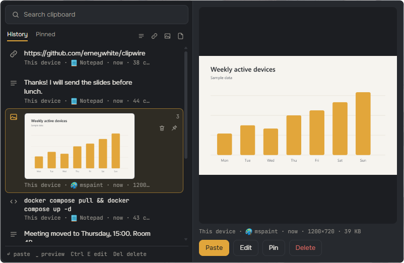
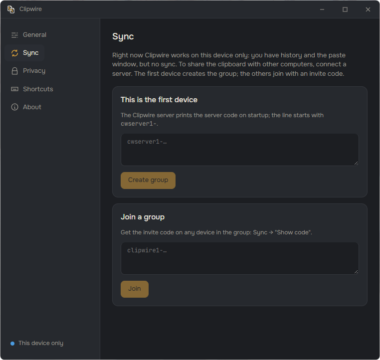
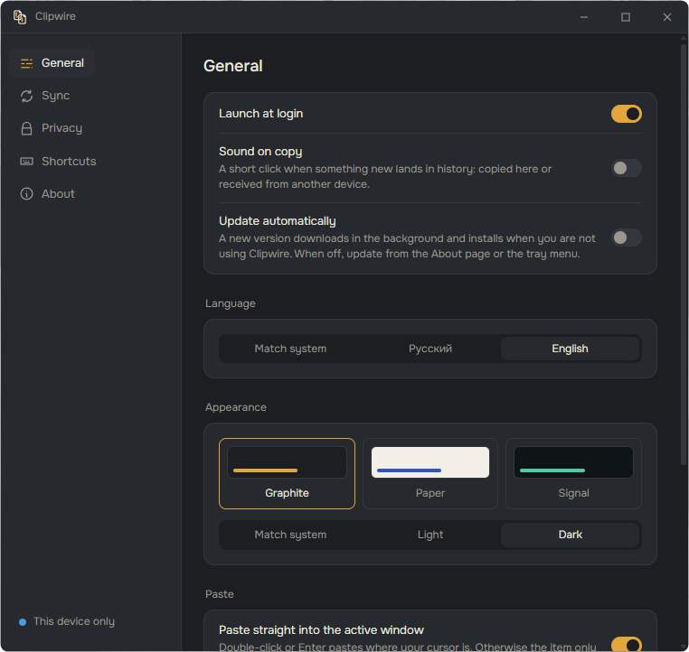

<p align="center">
  
</p>

<h1 align="center">Clipwire</h1>

<p align="center">
  <b>Общий буфер обмена для ваших компьютеров через свой сервер</b><br>
  <i>Скопировали здесь, вставили там.</i>
</p>

<p align="center">
  <a href="https://github.com/erneywhite/clipwire/actions/workflows/ci.yml"></a>
  <a href="https://github.com/erneywhite/clipwire/releases/latest"></a>
  <a href="LICENSE"></a>
  <a href="https://ko-fi.com/erneywhite"></a>
</p>

<p align="center">
  <a href="README.md">English</a> · <b>Русский</b>
</p>

<p align="center">
  
</p>

Clipwire — бесплатный общий буфер обмена. Скопировали на одном компьютере, вставили на другом.
Текст с форматированием, картинки, файлы и папки идут через сервер, который вы разворачиваете
сами, и всё шифруется на устройствах (E2E): сервер видит только шифротекст, а ключ хранится
только у вас.

Сервер — один контейнер Docker. У клиента есть зашифрованная история с поиском и небольшое окно
вставки, которое открывается рядом с курсором мыши. Без сервера клиент работает как локальная
история буфера на одном компьютере, сервер можно подключить позже.

Сейчас есть клиент для Windows. Клиенты для macOS и Linux в планах.

Нашли баг или есть идея? Пишите в [Issues](https://github.com/erneywhite/clipwire/issues).

*Скриншоты в английском интерфейсе. Программа сама выберет русский, если он стоит в системе.*

## Содержание

- [Начало работы](#начало-работы)
- [Окно вставки](#окно-вставки)
- [Что синхронизируется](#что-синхронизируется)
- [Редактор картинок](#редактор-картинок)
- [Устройства и группы](#устройства-и-группы)
- [Хранилище файлов (S3 и SFTP)](#хранилище-файлов-s3-и-sftp)
- [Приватность и безопасность](#приватность-и-безопасность)
- [Обновления](#обновления)
- [Настройки](#настройки)
- [Свой сервер](#свой-сервер)
- [Сборка и тесты](#сборка-и-тесты)
- [Устройство репозитория](#устройство-репозитория)
- [Поддержка](#поддержка)
- [Лицензия](#лицензия)

## Начало работы

<p align="center">
  
</p>

1. Скачайте `Clipwire_*_x64-setup.exe` из [релизов](https://github.com/erneywhite/clipwire/releases)
   и запустите. Установщик ставит программу на текущего пользователя, права администратора не нужны.
2. Запустите Clipwire. Он живёт в трее, окно вставки открывается по Ctrl+Shift+V.

**Без сервера.** История и окно вставки работают на одном компьютере. Сервер можно подключить в
любой момент: последние 50 записей локальной истории уйдут в группу, а история группы
вольётся в локальную. Сам буфер обмена при этом не меняется.

**Подключение сервера.** Сначала поднимите сервер (см. [Свой сервер](#свой-сервер)), он печатает
код сервера вида `cwserver1-…`.

1. На первом устройстве откройте «Синхронизацию», введите код сервера и создайте группу.
2. Clipwire покажет код приглашения `clipwire1-…`. Введите его на остальных устройствах.

В коде приглашения лежит ключ шифрования группы, поэтому передавайте его только себе.

## Окно вставки

Нажмите Ctrl+Shift+V (меняется в настройках). Окно появится у курсора мыши.

| Клавиши | Действие |
|---|---|
| ↑ ↓, мышь | выбрать |
| Enter, двойной клик | вставить туда, где стоит текстовый курсор (и отправить на остальные устройства) |
| Shift+Enter | вставить без форматирования |
| Ctrl+1…9 | вставить элемент по номеру |
| Пробел | предпросмотр (при пустом поиске) |
| Ctrl+P, клик по булавке справа в строке | закрепить или открепить |
| Ctrl+E | изменить картинку |
| Delete (при пустом поиске), Shift+Delete, корзина в строке | удалить из истории |
| Правый клик, клавиша меню, Shift+F10 | меню записи: вставить, просмотр, изменить, закрепить, удалить |
| Tab | История ↔ Закреплённое |
| Alt+← →, значки справа от вкладок | фильтр: текст, ссылки, картинки, файлы |
| Набор текста | поиск |

В предпросмотре текст можно поправить перед вставкой: Ctrl+Enter вставит изменённый вариант,
Ctrl+S сохранит правку в истории.

**Удаление.** По умолчанию удалённая запись пропадает только на этом устройстве. Если включить
в «Синхронизации» «Удалять на всех устройствах», удаление уйдёт и на остальные устройства
группы. Выключенные устройства применят его, когда подключатся, в пределах срока хранения на
сервере. Закреплённое на другом устройстве не удаляется. Сервер не знает, что именно удалили:
записка об удалении зашифрована ключом группы. Нужен сервер 0.1.3 или новее.

## Что синхронизируется

### Текст и форматирование

Если копировать из браузера, Word или почты, вместе с текстом сохраняются HTML и RTF. Вставка
идёт с форматированием. Shift+Enter (или кнопка «Без форматирования» в предпросмотре) вставляет
только текст, а в настройках можно сделать так всегда. В списке такие записи помечены `HTML` или
`RTF`. Предпросмотр показывает их в изолированном фрейме: скрипты не выполняются, внешние
картинки и шрифты не загружаются, поэтому просмотр письма не сообщает отправителю, что его
открыли. Если форматированный текст не влезает в лимит отправки, на другие устройства он уходит
без форматирования.

### Картинки

Скопированная картинка (скриншот, картинка из браузера или редактора) уходит на остальные
устройства в PNG без потерь и показывается в окне вставки крупной миниатюрой с размером и
весом. По пробелу открывается целиком. Если в буфере и текст, и картинка (так делают Excel и
некоторые редакторы), синхронизируется текст. Картинки больше примерно 7,5 МБ в PNG не
отправляются, а лимит одного элемента на сервере по умолчанию 8 МиБ.

### Файлы и папки

Файлы и папки, скопированные в Проводнике, попадают в историю карточкой с именем, размером и
путём. Вставка кладёт их обратно в буфер так же, как Проводник, так что их можно вставить в
папку, мессенджер или письмо. Файл-картинка (png, jpg, webp, gif, bmp) получает миниатюру,
предпросмотр и редактор. Если скопировано несколько файлов, в предпросмотре можно снять отметки
и вставить только выбранные.

По пробелу у текстовых файлов видно начало (до 64 КБ), PDF открывается во встроенном
просмотрщике, видео (mp4, webm, mov) и аудио (mp3, m4a, wav, ogg, flac) играют во встроенном
плеере. Видео читается прямо с диска кусками, поэтому размер значения не имеет. PDF и медиа
открываются, только если начало файла совпадает с форматом, так что файл с чужим расширением
страницей не откроется. Окно получает доступ только к файлам из истории. Кнопка «Показать в
папке» открывает Проводник на файле.

**Передача на другие устройства.** Внутри группы:

- Файл до порога (по умолчанию 100 МБ, меняется в «Синхронизации», 0 значит не загружать) сразу
  заливается на сервер зашифрованным, а карточка появляется на всех устройствах. Каждый файл
  шифруется своим ключом, выведенным из ключа группы, по частям в 1 МиБ, поэтому сервер видит
  только шифротекст.
- При вставке на другом устройстве файл скачивается в кэш (`%APPDATA%\Clipwire\config\files`) и
  кладётся в буфер как обычный файл. Прогресс отправки и скачивания виден в строке окна
  вставки, а отправленные файлы сутки помечены «↑ на сервере». Пометка переживает перезапуск и не
  зависит от `CLIPWIRE_TTL_HOURS` сервера.
- Обрыв связи не страшен: загрузка и скачивание продолжаются с места остановки, очередь
  загрузок переживает перезапуск. Если файл изменили, пока он отправлялся, отправка отменяется.
- Папка уходит одним архивом tar без сжатия и на другом устройстве распаковывается в кэш. Ссылки
  в архив не попадают, а папки больше 100 000 записей или глубже 64 уровней не передаются.
- Файлы и папки больше порога на сервер не загружаются. Получатель берёт их напрямую с
  устройства-источника через iroh, пока оно в сети. Источник сначала проверяет, что
  спрашивающий знает ключ группы, поэтому посторонние ничего не получат. В строке написано
  «напрямую с устройства «X»», а если источник выключен, при скачивании появится «устройство «X»
  не в сети».

Устройства группы лучше обновлять вместе: версии до прямой передачи не понимают новые файловые
записи. Подробности протокола в [docs/files-transfer.md](docs/files-transfer.md).

**Кэш скачанного.** Скачанная копия живёт, пока есть её запись в истории. После удаления записи,
очистки истории или чистки по сроку хранения копия удаляется сама, и при запуске программы тоже.
В «Синхронизации» → «Файлы» видно, сколько места занимает кэш. Кнопка «Очистить кэш скачанного»
удаляет всё, кроме того, что скачивается прямо сейчас, а удалённое скачается заново при
вставке.

### Вложения Outlook

Вложение, скопированное в Outlook, и само письмо (оно станет файлом `.msg`) тоже попадают в
историю файлами. Так же работают другие программы, которые кладут в буфер файлы без пути на
диске, например архиваторы. Clipwire сохраняет их в `%APPDATA%\Clipwire\config\virtual` и
дальше обращается с ними как с обычными файлами.

За одно копирование берётся до 500 файлов общим размером не больше порога загрузки (если порог
0, до 100 МБ). Если больше или источник не отвечает 30 секунд, копирование пропускается. Если
пока вложение читалось, скопировали что-то другое, вложение встанет в историю, но в буфер и на
другие устройства не уйдёт. Сохранённые файлы помечаются как полученные из интернета, поэтому
Windows и Office предупредят перед запуском. Они лежат, пока на них ссылается запись истории.
Картинка, скопированная в Firefox или Thunderbird, остаётся картинкой, хотя браузер кладёт рядом
и файл.

### Карточки ссылок

Если в буфере ссылка, по пробелу вместо текста показывается карточка с заголовком, описанием и
картинкой страницы из её og-тегов. Её загружает сама программа, без встроенного браузера:
страница не открывается и не исполняется, читается только начало HTML (до 512 КБ) и одна
картинка (до 2 МБ), таймаут 8 секунд.

Ссылки, похожие на одноразовые (вход по ссылке, сброс пароля, подтверждение почты, подписанные
ссылки на файлы), не загружаются вообще: переход по такой ссылке может её сжечь. Ссылки на этот
компьютер и в локальную сеть (localhost, 192.168.x.x, 10.x.x.x и подобные) тоже не
загружаются, в том числе после редиректа. Кнопка «Открыть в браузере» открывает ссылку в
браузере по умолчанию. Загрузку карточек можно выключить в разделе «Приватность».

### Приложение-источник

У записи видно, откуда её скопировали: маленькая иконка и имя программы («Блокнот»,
«Telegram»). Имя берётся из описания exe, иконка 32×32 из самого exe. Поиск находит записи и
по имени программы. Имя и иконка уходят вместе с записью, поэтому другие устройства группы
тоже видят источник. Определяется на Windows.

## Редактор картинок

Нажмите Ctrl+E (или «Изменить» в предпросмотре), чтобы сделать заметку на скриншоте и сразу её
вставить.

Инструменты: стрелка (A), перо (P), маркер (M), рамка (R), эллипс (E), текст в плашке (T),
размытие области (B), например чтобы закрыть пароль или адрес, и обрезка (C). Режим выбора (V)
двигает и удаляет готовые фигуры. Цвета переключаются клавишами 1–6, толщина клавишами `[` и
`]`. Shift при рисовании даёт квадрат, круг или стрелку под углом, кратным 45°. Ctrl+Z
отменяет.

Ctrl+Enter вставляет результат в окно, где вы были, Ctrl+S только сохраняет. Изменённая
картинка становится новой записью в истории и уходит на остальные устройства, оригинал
остаётся.

## Устройства и группы

В «Синхронизации» видно, какие устройства в группе: имя, ОС, короткий отпечаток, в сети ли
устройство и когда заходило последний раз. Имя и ОС каждое устройство публикует само, в
зашифрованной карточке, подписанной его ключом, поэтому сервер их не видит и подменить не
может. Устройство со старой версией Clipwire показывается как «неизвестное устройство».

**Удаление устройства.** Потерянный или проданный компьютер можно удалить из группы кнопкой
«Удалить». Ключ группы меняется, остальные устройства получают новый ключ сами (выключенные
когда включатся, в течение 30 дней), а удалённое теряет доступ к серверу, файлам и прямой
передаче. На нём синхронизация останавливается, а в «Синхронизации» появляются кнопки «Выйти из
группы» и «Попробовать снова». Ключ и история сами не стираются: сказать «вас исключили» сервер
может и без смены ключа, а то, что на устройстве уже было, остаётся. Новый ключ принимается,
только если его выпустило устройство группы, которое этот компьютер уже видел в списке. После
смены в настройках написано, какое устройство её сделало.

**Смена ключа группы** делает то же без удаления и пригодится, если код приглашения попал не
туда. История группы на сервере стирается, локальная история не трогается, а код приглашения
меняется. Устройства без карточки новый ключ не получают, и перед подтверждением программа об
этом предупреждает.

Подробности в [docs/devices.md](docs/devices.md).

## Хранилище файлов (S3 и SFTP)

По умолчанию файлы до порога лежат на сервере Clipwire. Группа может держать их в своём
хранилище: S3-совместимом (AWS, MinIO, Backblaze B2, Cloudflare R2) или на SFTP-сервере. Это
пригодится, когда на сервере мало места.

Выбор делается в «Синхронизации» → «Хранилище файлов» (карточка есть, только когда устройство в
группе): «Сервер Clipwire», «S3-совместимое» или «SFTP», срок хранения файлов, затем кнопки
«Проверить подключение» и «Сохранить». Проверка записывает, читает и удаляет пробный объект.

- Настройки шифруются ключом группы и расходятся по устройствам через сервер, который доступов
  не видит. В хранилище попадает тот же шифротекст, что ушёл бы на сервер.
- S3 работает только по HTTPS, HTTP разрешён лишь для `localhost` и адресов локальной сети.
- У SFTP ключ хоста сверяется с отпечатком, который вы подтвердили при первой проверке, а
  пароль неизвестному хосту не отправляется. Закрытый ключ можно вставить текстом или выбрать
  файлом.
- Сохранённые секреты (секретный ключ, пароль, закрытый ключ) в окно не возвращаются. Пустое
  поле значит «оставить как есть».
- Если хранилище недоступно, файл уходит через сервер Clipwire и появляется предупреждение.
- Старые файлы устройства удаляют сами, не чаще раза в час, по сроку из настроек группы и по
  часам самого хранилища. Для S3 стоит добавить такое же правило жизненного цикла в бакете.
- Если из группы исключили устройство или при смене ключа остались устройства без карточки,
  доступы к хранилищу у них сохраняются. Программа предложит сменить ключ S3 или пароль и ключ
  SSH.

Полное описание в [docs/storage.md](docs/storage.md).

## Приватность и безопасность

- Всё шифруется на устройствах (E2E). Сервер видит только шифротекст, ключ есть только у ваших
  устройств.
- История хранится на устройстве в SQLite, каждая запись зашифрована локальным ключом под
  DPAPI.
- Содержимое, которое менеджеры паролей помечают как приватное, не синхронизируется никогда.
  Отдельные программы можно исключить из синхронизации, по умолчанию в списке менеджеры паролей.
- Файлы, скачанные с других устройств, Windows считает полученными из интернета и предупреждает
  перед их запуском.
- Элемент, скопированный на другом устройстве больше 10 минут назад (например, дошёл с
  опозданием), попадает только в историю, буфер он не трогает.
- Карточки ссылок не исполняют страницу и не загружают одноразовые ссылки (см.
  [Карточки ссылок](#карточки-ссылок)).
- При выходе из группы удаляется и кэш скачанных файлов.
- Настройки и ключи лежат в `%APPDATA%\Clipwire`.

## Обновления

Clipwire обновляется тихо. Раз в 6 часов он проверяет релизы на GitHub и скачивает новую версию
в фоне. Ставится она без окна установщика, когда окна Clipwire закрыты, файлы не передаются (в
том числе напрямую на другое устройство), синхронизация не на паузе, а программой и буфером
пользовались не меньше пары минут назад. Не успела до выхода, поставится при следующем
запуске. После обновления приходит уведомление, пауза синхронизации сохраняется. Если установка
не прошла, придёт уведомление об этом, и эту версию программа сама больше не ставит, только по
кнопке.

Обновление проверяется по цифровой подписи, а номер версии из ответа сервера сверяется с
версией внутри подписи. Подменённый файл или старый установщик под новым номером не
установятся.

Настройку «Обновляться автоматически» в разделе «Основные» можно выключить: тогда обновление
ставится только по кнопке в «О программе» или в меню трея. Подробнее в
[docs/updates.md](docs/updates.md).

## Настройки

<p align="center">
  
</p>

- Три темы оформления (Графит, Бумага, Сигнал), у каждой светлый и тёмный вариант, либо как в
  системе.
- Язык: English, Русский или как в системе.
- Автозапуск: при входе в систему программа запускается свёрнутой в трей.
- Звук копирования: короткий щелчок, когда в историю попадает новое. Вставка из истории и
  повторное копирование того же самого звука не дают. Только на Windows.
- Срок хранения истории, от дня до «всегда» (закреплённое хранится всегда).
- Имя устройства, код приглашения, отключение от группы.
- Размер окна вставки (один ползунок, рядом показывается живое окно) и горячая клавиша.
- Список программ, из которых не синхронизировать (по умолчанию менеджеры паролей).
- Скрытие окон при демонстрации экрана.
- Карточки ссылок, вставка без форматирования по умолчанию, автообновление.

В «О программе» сверху версия и проверка обновлений, ниже блок «Состояние»: связь с сервером и
как она идёт (напрямую по UDP или через relay, с задержкой), когда последний раз элемент ушёл и
пришёл, хранилище файлов группы, сколько записей в истории на этом устройстве и сколько места
занимают скачанные файлы, сколько элементов и файлов группы лежит на сервере, сколько места под
файлы занято из квоты сервера (`CLIPWIRE_BLOB_QUOTA`), сколько устройств в группе и сколько из
них в сети. Цифры сервера показывает сервер 0.1.2 и новее. Там же кнопка Ko-fi.

## Свой сервер

Сервер — один контейнер со встроенным relay iroh. Наружу нужны HTTPS (обратный прокси перед
relay) и, по желанию, UDP-порт для прямых QUIC-соединений. Без него всё работает через relay,
только чуть медленнее.

Готовый образ собирает GitHub Actions: `ghcr.io/erneywhite/clipwire-server:latest` (последний
`main`) и `:X.Y.Z` для релизов.

**Через панель управления с Docker или просто `docker compose`:**

1. Создайте compose-проект из [deploy/docker-compose.image.yml](deploy/docker-compose.image.yml),
   замените `CLIPWIRE_PUBLIC_URL` на свой домен и запустите.
2. Создайте обратный прокси на этот домен с адресом `http://127.0.0.1:3340`, включите SSL и
   WebSocket. Если переключателя WebSocket нет, вставьте в конфиг сайта блок из
   [deploy/nginx-clipwire.conf](deploy/nginx-clipwire.conf).
3. По желанию откройте UDP 7843 в файрволе.
4. По желанию закройте служебную страницу iroh-relay на корне домена: добавьте в конфиг прокси
   `location = /` с редиректом, пример в конце
   [deploy/nginx-clipwire.conf](deploy/nginx-clipwire.conf).
5. Возьмите из лога контейнера строку `код сервера: cwserver1-…`. С ней подключается первое
   устройство. То же печатает `clipwire-server info`.

**Обновление:** скачайте свежий образ (pull) и пересоздайте контейнер.

**Проверка снаружи:** `cargo run -p clipwire-server --example probe -- cwserver1-…`. Проба
подключает два клиента через relay, гоняет между ними зашифрованный элемент и показывает, каким
путём шли пакеты.

**Сборка образа самому:** `docker compose up -d --build` в каталоге `deploy`
([deploy/docker-compose.yml](deploy/docker-compose.yml)).

Ключ сервера, токен relay и база лежат в томе Docker `clipwire-data`. Если удалить ключ, у
сервера сменится адрес, и устройства придётся подключать заново.

### Переменные окружения

| Переменная | По умолчанию | Что это |
|---|---|---|
| `CLIPWIRE_PUBLIC_URL` | обязательна | публичный адрес, например `https://clip.example.com` |
| `CLIPWIRE_DATA_DIR` | `/data` в образе | ключ, токен, база |
| `CLIPWIRE_RELAY_BIND` | `0.0.0.0:3340` | HTTP встроенного relay |
| `CLIPWIRE_QUIC_BIND` | `0.0.0.0:7843` | UDP для прямых соединений |
| `CLIPWIRE_RELAY_TOKEN` | генерируется | токен доступа к relay, если хочется задать свой (не длиннее 256 символов) |
| `CLIPWIRE_MAX_ITEM_BYTES` | `8388608` | предел одного зашифрованного элемента (8 МиБ, под картинки) |
| `CLIPWIRE_HISTORY_LEN` | `50` | сколько последних элементов хранить на группу |
| `CLIPWIRE_TTL_HOURS` | `24` | сколько хранить элемент |
| `CLIPWIRE_SELF_RELAY_URL` | `http://127.0.0.1:<порт relay>` | как сервер сам подключается к своему relay |
| `CLIPWIRE_MAX_FILE_BYTES` | `104857600` | предел одного файла (100 МиБ) |
| `CLIPWIRE_BLOB_QUOTA` | `2147483648` | место под файлы на одну группу (2 ГиБ) |
| `CLIPWIRE_BLOB_TOTAL_QUOTA` | `21474836480` | место под файлы на весь сервер (20 ГиБ) |
| `CLIPWIRE_BLOB_STALL_SECS` | `120` | сколько ждать следующую часть файла, прежде чем считать загрузку брошенной |
| `CLIPWIRE_RESERVE_TTL_SECS` | `600` | через сколько освобождается место, зарезервированное под файл, если загрузка так и не началась |
| `CLIPWIRE_MAX_RESERVES` | `512` | сколько файлов одно устройство может держать зарезервированными без единой загруженной части |
| `CLIPWIRE_MAX_GROUPS` | `100` | сколько групп можно создать на сервере (создать группу можно только с кодом сервера; группы без устройств 90 дней удаляются сами) |
| `CLIPWIRE_HISTORY_TOTAL_BYTES` | `1073741824` | общий предел истории элементов на сервер (1 ГиБ); лишнее вытесняется у самой большой группы |
| `CLIPWIRE_MAX_DEVICE_CONNS` | `4` | сколько одновременных соединений с одного устройства |

### Что хранит сервер

- Зашифрованные элементы: срок `CLIPWIRE_TTL_HOURS`, не больше `CLIPWIRE_HISTORY_LEN` на группу.
- Зашифрованные файлы в `<CLIPWIRE_DATA_DIR>/blobs`, они удаляются по тому же сроку.
- Если группа выбрала своё хранилище (S3 или SFTP), только его зашифрованные настройки, до
  16 КБ. Сервер рассылает их устройствам группы. При смене ключа группы и вместе с группой они
  удаляются.
- Зашифрованные карточки устройств (имя, ОС, ключ для смены ключа группы). Содержимое видят
  только устройства.
- Пакеты с новым ключом и список устройств старой группы после удаления устройства: они живут
  30 дней, чтобы выключенные устройства успели забрать свой ключ. Потом от старой группы
  остаётся только запись-надгробие: вход со старым ключом получает «исключено» и группу заново
  не создаёт. Надгробия не считаются в `CLIPWIRE_MAX_GROUPS`.
- Зашифрованные записки об удалении.

Сервер видит только шифротекст. Когда устройство удаляют из группы, сервер сразу стирает
историю и файлы старой группы, оставшимся устройствам отдаёт новый ключ, упакованный для
каждого отдельно, а удалённому сообщает, что его исключили. Подробнее в
[docs/devices.md](docs/devices.md) и [docs/architecture.md](docs/architecture.md).

## Сборка и тесты

Нужны Rust stable (проверено на 1.100), Node.js 22+, на Windows ещё MSVC Build Tools.

```
cargo test --workspace
cd apps/desktop && npm ci && npx tauri dev
```

Релиз собирается в GitHub Actions по тегу `vX.Y.Z` ([release.yml](.github/workflows/release.yml)):
установщик, подписанные файлы обновления и `latest.json`. Версия берётся из `Cargo.toml`
рабочего пространства.

Иконки, картинки установщика и знак в README собираются из исходников в `docs/brand/` скриптом
`node apps/desktop/scripts/icons.mjs`, затем `npx tauri icon apps/desktop/icons-src/icon-1024.png`
(из каталога `apps/desktop`).

**Что покрывают тесты.**

- `crates/clipwire-server/tests/e2e.rs` поднимает настоящий сервер с relay на 127.0.0.1 и гоняет
  через него несколько клиентов.
- Тесты агента в `crates/clipwire-agent/tests` работают с таким же настоящим сервером.
  `sync.rs` проверяет движок синхронизации, `devices.rs` карточки устройств и смену ключа группы
  (удаление устройства, вход выключенного устройства после смены, смена без удаления, смена
  ключа незнакомым устройством), `files.rs` передачу файлов (загрузка и скачивание в кэш,
  докачка после обрыва, скачивание во время загрузки, отказ сервера, прямая передача с
  устройства, папки через сервер и напрямую), `storage.rs` настройки группы через сервер и файлы
  через внешнее хранилище (папка на диске вместо бакета) с откатом на сервер, `sftp.rs`
  SFTP-хранилище против SSH-сервера в том же процессе (ключ хоста, вход паролем и ключом,
  проверка подключения, чистка).
- Подпись S3 проверяется на официальных примерах AWS
  (`crates/clipwire-agent/src/storage/sigv4.rs`).

**Ручные тесты на живых хранилищах.** `s3_live.rs` проверяет S3 на настоящем сервере: проверку
подключения, запись и чтение, файл из нескольких частей, список длиннее 1000 объектов, чистку по
сроку и тексты ошибок (неверный ключ, нет бакета, нет связи). Бакет должен уже существовать,
проверено на MinIO:

```bash
CLIPWIRE_S3_ENDPOINT=http://127.0.0.1:9000 CLIPWIRE_S3_BUCKET=clipwire-test CLIPWIRE_S3_ACCESS=... CLIPWIRE_S3_SECRET=... cargo test -p clipwire-agent --test s3_live -- --ignored
```

`sftp_live.rs` так же проверяет SFTP на настоящем OpenSSH: отпечаток ключа хоста, вход паролем и
ключом с паролем к нему, файл из нескольких частей, чистку, неверный пароль и чужой отпечаток.
Проверено и с `MaxSessions 1`:

```bash
CLIPWIRE_SFTP_HOST=127.0.0.1 CLIPWIRE_SFTP_PORT=2222 CLIPWIRE_SFTP_USER=... CLIPWIRE_SFTP_PASSWORD=... CLIPWIRE_SFTP_PATH=/папка CLIPWIRE_SFTP_KEY=путь/к/ключу CLIPWIRE_SFTP_KEY_PASS=... cargo test -p clipwire-agent --test sftp_live -- --ignored
```

**Тесты фронтенда.** Чистая логика окна настроек проверяется без сборки, в Node 23.6+ (он сам
убирает типы). Из каталога `apps/desktop`: `node src/lib/storage.test.ts` (поля карточки
«Хранилище файлов», сохранённые секреты, сброс отпечатка ключа хоста),
`node src/lib/i18n.test.ts`, `devices.test.ts`, `overview.test.ts` и `transfer.test.ts`.

В крейте агента есть консольный клиент для отладки: `create`, `join`, `run` (синхронизация без
интерфейса), `listen`, `send <текст>`. Переменная `CLIPWIRE_HOME` задаёт другой каталог
настроек, так на одной машине можно запустить два клиента.

## Устройство репозитория

- `apps/desktop`: приложение (Tauri 2 и Svelte 5): иконка в трее, окно вставки у курсора, окно
  настроек, автообновление.
- `crates/clipwire-agent`: движок синхронизации, работа с буфером ОС, локальная история и
  консольный клиент для отладки.
- `crates/clipwire-server`: сервер со встроенным iroh-relay, группы устройств, раздача
  элементов и история с TTL.
- `crates/clipwire-core`: формат элементов, шифрование, коды сервера и приглашения.
- `docs/`: [архитектура](docs/architecture.md), [обзор готовых решений](docs/research.md),
  [передача файлов](docs/files-transfer.md), [устройства](docs/devices.md),
  [хранилище](docs/storage.md), [обновления](docs/updates.md) и исходники оформления
  (`docs/brand/`).
- `deploy/`: compose-файлы и пример обратного прокси для сервера.

## Поддержка

Clipwire бесплатный. Если он сэкономил вам время, можно [поддержать автора на Ko-fi](https://ko-fi.com/erneywhite).
Баги и идеи принимаются в [Issues](https://github.com/erneywhite/clipwire/issues).

## Лицензия

[AGPL-3.0](LICENSE). Пользоваться, менять и распространять можно. Если вы публикуете изменённую
версию, в том числе сервер, к которому подключаются по сети, её исходный код нужно открыть под
той же лицензией.

Автор: Erney White
