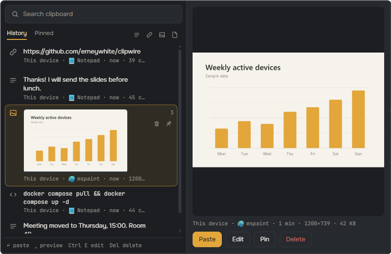
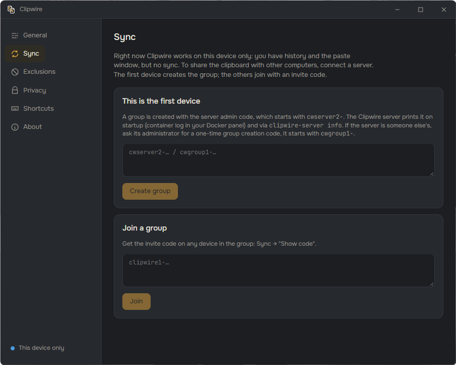
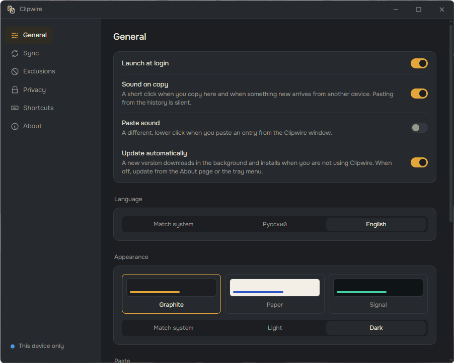

<p align="center">
  
</p>

<h1 align="center">Clipwire</h1>

<p align="center">
  <b>Общий буфер обмена для ваших компьютеров через свой сервер</b><br>
  <i>Скопировали здесь, вставили там.</i>
</p>

<p align="center">
  <a href="https://github.com/erneywhite/clipwire/actions/workflows/ci.yml"></a>
  <a href="https://github.com/erneywhite/clipwire/releases/latest"></a>
  <a href="LICENSE"></a>
  <a href="https://ko-fi.com/erneywhite"></a>
</p>

<p align="center">
  <a href="README.md">English</a> · <b>Русский</b>
</p>

<p align="center">
  
</p>

Clipwire — бесплатный общий буфер обмена. Скопировали на одном компьютере, вставили на другом.
Текст с форматированием, картинки, файлы и папки идут через сервер, который вы разворачиваете
сами, и всё шифруется на устройствах (E2E): сервер видит только шифротекст, а ключ хранится
только у вас.

Сервер — один контейнер Docker. У клиента есть зашифрованная история с поиском и небольшое окно
вставки, которое открывается рядом с курсором мыши. Без сервера клиент работает как локальная
история буфера на одном компьютере, сервер можно подключить позже.

Есть клиенты для Windows, macOS (13 Ventura и новее, Apple Silicon и Intel) и Linux (x86-64;
X11 и Wayland: GNOME, KDE Plasma, Sway, Hyprland и другие).

Нашли баг или есть идея? Пишите в [Issues](https://github.com/erneywhite/clipwire/issues).

*Скриншоты в английском интерфейсе. Программа сама выберет русский, если он стоит в системе.*

## Содержание

- [Начало работы](#начало-работы)
- [Окно вставки](#окно-вставки)
- [Что синхронизируется](#что-синхронизируется)
- [Редактор картинок](#редактор-картинок)
- [Устройства и группы](#устройства-и-группы)
- [Хранилище файлов (S3 и SFTP)](#хранилище-файлов-s3-и-sftp)
- [Приватность и безопасность](#приватность-и-безопасность)
- [Обновления](#обновления)
- [Настройки](#настройки)
- [Свой сервер](#свой-сервер)
- [Сборка и тесты](#сборка-и-тесты)
- [Устройство репозитория](#устройство-репозитория)
- [Поддержка](#поддержка)
- [Лицензия](#лицензия)

## Начало работы

<p align="center">
  
</p>

**Windows.**

1. Скачайте `Clipwire_*_windows_x64-setup.exe` из [релизов](https://github.com/erneywhite/clipwire/releases)
   и запустите. Установщик ставит программу на текущего пользователя, права администратора не нужны.
2. Запустите Clipwire. Он живёт в трее, окно вставки открывается по Ctrl+Shift+V.

**macOS.**

1. Скачайте `Clipwire_*_macos_universal.dmg` из [релизов](https://github.com/erneywhite/clipwire/releases),
   откройте и перетащите Clipwire в «Программы».
2. Первый запуск. Clipwire не нотаризован Apple (для этого нужен платный аккаунт разработчика),
   поэтому macOS скажет, что не может проверить программу. Откройте Clipwire один раз, закройте
   предупреждение, затем «Системные настройки» → «Конфиденциальность и безопасность» и нажмите
   **«Всё равно открыть»** у строки про Clipwire. Или один раз в Терминале:
   `xattr -dr com.apple.quarantine /Applications/Clipwire.app`.
   Это нужно только в первый раз: обновления Clipwire ставит сам.
3. Clipwire живёт в строке меню (иконки в Dock нет), окно вставки открывается по Cmd+Shift+V.
4. Чтобы вставлять сразу в окно, где вы были, Clipwire нужно разрешение **«Универсальный доступ»**.
   При первой вставке он объяснит, как его дать, и откроет нужный раздел настроек; до этого
   выбранная запись просто кладётся в буфер. Обновления разрешение не сбрасывают: все версии
   подписаны одним сертификатом.

**Linux.**

1. Скачайте из [релизов](https://github.com/erneywhite/clipwire/releases):
   - Ubuntu, Debian, Linux Mint, Pop!_OS — `Clipwire_*_linux_amd64.deb`, затем
     `sudo apt install ./Clipwire_*_linux_amd64.deb`;
   - любой другой дистрибутив — `Clipwire_*_linux_amd64.AppImage`, затем
     `chmod +x Clipwire_*_linux_amd64.AppImage` и запустите его.
2. Запустите Clipwire из меню программ. Он живёт в трее, окно вставки открывается по Ctrl+Alt+V
   (на Linux Ctrl+Shift+V — вставка в терминалах, поэтому сочетание другое).
3. **Значок в трее в GNOME.** В Ubuntu значки в трее видны сразу. В других дистрибутивах с GNOME
   (Fedora, Debian) поставьте расширение [AppIndicator and KStatusNotifierItem Support](https://extensions.gnome.org/extension/615/appindicator-support/),
   иначе значка не будет (Clipwire при этом работает, открывайте его из меню).
4. **Wayland.** В GNOME и KDE Plasma окно вставки открывается у трея, в других оболочках — по
   центру экрана. Чтобы оно вставляло само, включите
   **«Сразу вставлять в активное окно»**: система один раз спросит разрешение, см.
   [Окно вставки](#окно-вставки). Сочетание само регистрируется в оболочке в GNOME, KDE Plasma и
   Hyprland; в Sway назначьте `clipwire --popup` на клавишу сами.
5. Ключи хранятся в системном хранилище паролей (GNOME Keyring, KWallet).

**Без сервера.** История и окно вставки работают на одном компьютере. Сервер можно подключить в
любой момент: последние 50 записей локальной истории уйдут в группу, а история группы
вольётся в локальную. Сам буфер обмена при этом не меняется.

**Подключение сервера.** Сначала поднимите сервер (см. [Свой сервер](#свой-сервер)), он печатает
код сервера вида `cwserver2-…`. Это код администратора, с ним создаются группы (см.
[Код администратора](#код-администратора)). Если сервер чужой, его администратор может выпустить вам
одноразовый код создания группы `cwgroup1-…` (см. [Коды создания группы](#коды-создания-группы)),
он вводится там же, где код сервера.

1. На первом устройстве откройте «Синхронизацию», введите код сервера `cwserver2-…` и создайте
   группу. Устройство станет админом группы и администратором сервера: в настройках появится
   раздел «Сервер». Старый код `cwserver1-…` группу не создаёт, приложение подскажет, где взять
   новый.
2. Clipwire покажет код приглашения `clipwire1-…`. Введите его на остальных устройствах.

В коде приглашения лежит ключ шифрования группы, поэтому передавайте его только себе.

**Переезд с Paste (macOS).** Историю [Paste](https://pasteapp.io) пока можно перенести утилитой
командной строки, кнопка в настройках — в планах. Текст и форматированный текст переносятся с
датами и программами-источниками, записи с досок становятся закреплёнными, а их названия —
подписями. Повторный перенос ставит закреп и подпись и на уже перенесённые записи; в группе
закрепы уходят на остальные устройства при следующем запуске Clipwire. Файлы пропускаются
(Paste хранит только ссылки на них), картинки переносятся с `--images`. Закройте Clipwire,
поставьте срок хранения истории «всегда» и запустите из репозитория:

```
cargo run --release -p clipwire-agent -- import-paste --dry-run   # только посчитать
cargo run --release -p clipwire-agent -- import-paste --send      # перенести и отправить в группу
```

macOS один раз спросит доступ к ключу Clipwire в связке ключей. Повторный запуск пропускает уже
перенесённое.

С `--send` перенесённое уходит и в группу. Остальные устройства должны быть на связи всё время
отправки: сервер хранит только последние записи группы (по умолчанию 50, `CLIPWIRE_HISTORY_LEN`),
и старые записи из Paste в эту историю не попадают, так что устройство не в сети их уже не получит.
Отправка идёт пачками, чтобы получатели успевали: текст быстро, картинки примерно по 1 МБ/с, архив
в несколько гигабайт уходит часами. Ход отправки утилита печатает по каждой сотне записей. При
обрыве связи она переподключается и продолжает с последней записи, которую подтвердил сервер. Если
связи нет дольше `--wait` минут (по умолчанию 10), утилита выходит с кодом 2 и печатает команду,
которой дослать остаток, например:

```
cargo run --release -p clipwire-agent -- import-paste --resend --images --since 1731700000000
```

`--resend` отправляет в группу то, что уже перенесено из Paste, не трогая историю: его записи
утилита находит по времени копирования. `--since` принимает дату `ГГГГ-ММ-ДД` или время в
миллисекундах из подсказки, `--skip N` пропускает N самых старых записей, `--limit N` ограничивает
отправку. Повтор уже отправленного безвреден: получатели отбрасывают совпадающие записи.

## Окно вставки

Нажмите Ctrl+Shift+V на Windows, Cmd+Shift+V на macOS или Ctrl+Alt+V на Linux (меняется в
настройках; на Linux Ctrl+Shift+V — вставка в терминалах). Окно появится у курсора мыши.

На Linux в сессии Xorg всё так же, в терминалы вставляется по Ctrl+Shift+V. На Wayland программам не видно курсор мыши и нельзя нажимать
клавиши в чужих окнах. В GNOME и KDE Plasma окно открывается в углу у панели, со стороны трея (окна
Clipwire там идут через XWayland, чтобы программа сама выбирала их место;
`CLIPWIRE_NATIVE_WAYLAND=1` оставляет нативные Wayland-окна). В других Wayland-оболочках — по
центру экрана. Enter только кладёт элемент
в буфер, вставляете вы сами по Ctrl+V.

**Чтобы на Wayland вставлялось само,** включите в «Вставке» **Сразу вставлять в активное окно**.
Система один раз спросит разрешение «управлять клавиатурой» (в GNOME это называется удалённым
рабочим столом или удалённым управлением). Звучит страшнее, чем есть: это стандартный системный
портал, которым пользуются программы удалённого доступа, и единственный способ, которым Wayland
разрешает программе нажать клавишу. Clipwire использует его ровно для одного — нажать Ctrl+V сразу
после того, как вы выбрали элемент. Экран он не видит, что вы печатаете, не читает, в фоне ничего
не делает. Пока Clipwire вставляет, GNOME показывает в верхней панели значок удалённого управления;
он пропадает через минуту после последней вставки. Разрешение запоминается; выключите переключатель —
и Clipwire его забудет. На Wayland не
видно, какое окно активно, поэтому нажимается всегда Ctrl+V; терминалы вставляют по Ctrl+Shift+V —
там нажмите его сами (элемент уже в буфере). Сочетание самой программы там не срабатывает в окнах других
программ, поэтому Clipwire регистрирует его в оболочке и обновляет, когда вы меняете его в
настройках Clipwire: в GNOME — среди своих сочетаний клавиш, в KDE Plasma — в службе сочетаний KDE
(«Параметры системы» → «Комбинации клавиш» → Clipwire), в Hyprland и других — через портал
глобальных сочетаний (оболочка может один раз спросить подтверждение). В Sway, где ничего из этого
нет, назначьте `clipwire --popup` на клавишу в его конфиге.

| Клавиши | Действие |
|---|---|
| ↑ ↓, мышь | выбрать |
| Enter, двойной клик | вставить туда, где стоит текстовый курсор (и отправить на остальные устройства) |
| Shift+Enter | вставить без форматирования |
| Ctrl+1…9 | вставить элемент по номеру |
| Пробел | предпросмотр (при пустом поиске) |
| Ctrl+P, клик по булавке справа в строке | закрепить или открепить |
| Ctrl+R | подписать закреплённую запись (Enter — сохранить, Esc — отмена) |
| Ctrl+E | изменить картинку |
| Delete (при пустом поиске), Shift+Delete, корзина в строке | удалить из истории; у закреплённой записи сначала выбор, что сделать |
| Правый клик, клавиша меню, Shift+F10 | меню записи: вставить, просмотр, изменить, закрепить, подписать, удалить |
| Tab | История ↔ Закреплённое |
| Alt+← →, значки справа от вкладок | фильтр: текст, ссылки, картинки, файлы |
| Набор текста | поиск |

В предпросмотре текст можно поправить перед вставкой: Ctrl+Enter вставит изменённый вариант,
Ctrl+S сохранит правку в истории.

Список листается до конца истории, в том числе с поиском и фильтрами: старые записи
подгружаются заранее, примерно за 50 записей до конца. Новая запись сверху не сбрасывает уже
подгруженное и место, где вы находитесь.

Поиск смотрит первые 8 КБ каждого текста, подписи закреплённых, имена файлов, устройство и программу-источник:
совпадение дальше в очень длинном тексте не найдётся. История читается с диска по страницам,
поэтому память не растёт вместе с ней (подробности — в `docs/history-storage.md`).

**Удаление.** По умолчанию удалённая запись пропадает только на этом устройстве. Если включить
в «Синхронизации» «Удалять на всех устройствах», удаление уйдёт и на остальные устройства
группы. Выключенные устройства применят его, когда подключатся, в пределах срока хранения на
сервере. Закреплённое на другом устройстве не удаляется. Сервер не знает, что именно удалили:
записка об удалении зашифрована ключом группы. Нужен сервер 0.1.3 или новее.

**Что отправлять.** В «Синхронизации» можно выключить отправку текста, картинок, файлов или
папок. Выключенное остаётся в истории этого устройства, но на другие не уходит. Что приходит
сюда, решают настройки других устройств. Если среди скопированного есть выключенное, например
папка рядом с файлами, не отправляется ничего.

**Закрепы и подписи.** Закреплённые записи одинаковы на всех устройствах группы, в том числе на
тех, что подключились позже или долго были выключены. У закреплённой записи может быть подпись
до 80 символов, поиск ищет и по ней. Открепление снимает закреп везде и стирает подпись, запись
остаётся в истории как обычная. Закрепить, открепить или подписать можно и без связи: правка
ждёт на диске и уходит после входа. При первом подключении к серверу с закрепами устройство
один раз выгружает свои прежние закрепы. Если два устройства без связи закрепили одно и то же,
остаётся один закреп с подписью более свежей правки. Закреп можно снять только на этом
устройстве: на остальных он останется, а сюда больше не вернётся, пока его не закрепят здесь
снова. Сервер хранит закрепы без срока, зашифрованными ключом группы, и не принимает новые сверх
своих пределов (`CLIPWIRE_PIN_MAX`, `CLIPWIRE_PIN_BYTES`): такая запись остаётся закреплённой
только здесь, и приложение об этом сообщает. Порядок правок решает сервер, а не часы устройств:
снятие или подпись, сделанные без связи, доходят до всех, даже если часы устройства отстают.
Если закреплённую запись просто удалить, закреп снимается только на этом устройстве, а на
остальных запись остаётся закреплённой. Повторное закрепление и повторный импорт из Paste не меняют
подпись, если она уже есть: подпись меняется только правкой подписи.

Файлы в закреплённых записях. Закреп заливает файлы записи в хранилище группы (на сервер или во
внешнее S3/SFTP) независимо от порога «сразу заливать»: папку архивом, большие файлы тоже. Если
файлов больше порога, окно вставки сначала спрашивает: «Закрепить и залить 1,2 ГБ в
хранилище?». Предел один, у сервера (`CLIPWIRE_MAX_FILE_BYTES`); файл больше него или сверх
места закрепов не зальётся, приложение скажет об этом, а файл останется доступен напрямую, пока
устройство-источник в сети. Файл, которого уже нет ни на диске, ни в кэше, залить нечем: закреп
остаётся, файл помечен недоступным. Залитые файлы закрепов не удаляются по сроку, пока закреп не
снят; после снятия они обычные и уходят по сроку. Внешнее хранилище чистят сами устройства по
списку файлов закрепов, который отдаёт сервер. Устройства со старой версией Clipwire (до
закрепов) этого списка не знают и могут удалить файлы закрепов из S3/SFTP по сроку хранения,
поэтому обновите приложение на всех устройствах группы.

При смене ключа группы устройство, которое его меняет, переносит закрепы в новую группу, а
если сервер не принял часть из них (предел закрепов), сообщает об этом. Файлы старой группы
сервер и внешнее хранилище удаляют, поэтому закрепы с файлами в новой группе заливаются заново.
Устройство, которое меняло ключ, делает это сразу, как войдёт с новым ключом, а файлы, которых у
него нет, заливают устройства, где они лежат на диске или в кэше, через несколько минут. Если
закреп по какой-то причине остался без файла (сервер его потерял, заливка не прошла), его так же
чинит устройство, у которого файл есть. Приложения 0.7 после такой починки видят у файла
старое место и пишут, что его нет, пока их не обновят. За один запуск приложение чинит не больше
1 ГиБ и 50 файлов: если закрепов с файлами больше, остальное дочинится после следующего запуска.

Что пока работает не идеально. Файл больше порога, залитый ради закрепа, после снятия закрепа
сразу удаляется с сервера, а в записи остаётся его новое место без прямой передачи: другие
устройства его больше не получат, пока файл не скопируют заново. Снятый и снова закреплённый
закреп заливает свои файлы заново.

Устройство, которое было выключено во время смены ключа, после перехода не
выгружает в новую группу закрепы, снятые за это время на других устройствах. Если база
сервера пропала или её восстановили из старой копии, устройства замечают это, забирают
закрепы с начала и выгружают свои живые закрепы заново.

Нужен сервер с протоколом `clipwire/8`: со старым сервером приложение не синхронизируется и
просит обновить образ.

Подпись стоит в строке заголовком цвета темы, под ней обычное содержимое: текст, картинка или
имя файла. Вставляется запись, подпись остаётся в окне. Задать или поменять подпись можно
сочетанием Ctrl+R (Cmd+R на macOS) или пунктом «Подписать…» в меню записи: поле появляется
прямо на месте заголовка, Enter сохраняет, Esc отменяет, пустое поле убирает подпись. В
предпросмотре подпись стоит сверху, щелчок по ней тоже открывает правку.

Delete, корзина или «Удалить» на закреплённой записи сначала спрашивают, что сделать:
«Снять закреп только здесь», «Снять закреп везде» (запись остаётся в истории) или «Удалить
везде». Выбирать стрелками и Enter или мышью, Esc закрывает выбор. Обычные записи удаляются
сразу, как раньше. Сколько закрепов лежит на сервере и сколько места они занимают вместе со
своими файлами, видно в «О программе» → «Состояние», строка «Закрепы на сервере».

## Что синхронизируется

Без связи последнее скопированное ждёт и уходит, как только сервер станет доступен. Если до
этого Clipwire закрыли или компьютер выключили, оно отправится при следующем запуске (текст,
форматированный текст и картинки; файлы, скопированные без связи, остаются на этом устройстве).

### Текст и форматирование

Если копировать из браузера, Word или почты, вместе с текстом сохраняются HTML и RTF. Вставка
идёт с форматированием. Shift+Enter (или кнопка «Без форматирования» в предпросмотре) вставляет
только текст, а в настройках можно сделать так всегда. В списке такие записи помечены `HTML` или
`RTF`. Предпросмотр показывает их в изолированном фрейме: скрипты не выполняются, внешние
картинки и шрифты не загружаются, поэтому просмотр письма не сообщает отправителю, что его
открыли. Если форматированный текст не влезает в лимит отправки, на другие устройства он уходит
без форматирования.

### Картинки

Скопированная картинка (скриншот, картинка из браузера или редактора) уходит на остальные
устройства в PNG без потерь и показывается в окне вставки крупной миниатюрой с размером и
весом. По пробелу открывается целиком. Если в буфере и текст, и картинка (так делают Excel и
некоторые редакторы), синхронизируется текст. Картинки больше примерно 7,5 МБ в PNG не
отправляются, а лимит одного элемента на сервере по умолчанию 8 МиБ.

Картинку можно вставить в папку файлом. Если окно вставки открыто поверх Проводника (или
рабочего стола), Finder или файлового менеджера Linux (Nautilus, Dolphin, Nemo, Thunar, Caja,
PCManFM), Clipwire кладёт в буфер не картинку, а файл «Снимок 2026-11-16 14-05-09.png». Файл
лежит во временной папке Clipwire и удаляется через сутки, запись в истории остаётся картинкой.
На Wayland программа не знает, какое окно было активным, и картинка вставляется как обычно.

На Windows то же работает и без окна Clipwire: когда в буфере оказывается картинка (скриншот,
«Копировать изображение» в браузере или картинка с другого устройства), Clipwire добавляет к ней
PNG-файл, и обычный Ctrl+V в Проводнике создаёт файл. Остальные программы, включая мессенджеры,
по-прежнему получают картинку. Буфер не трогается, если в нём кроме картинки есть текст, файлы
или свои форматы программы (так копируют графические редакторы и Office), если это скопировано
в программе из списка «не синхронизировать» и на паузе. После выхода из Clipwire картинка
остаётся в буфере, но уже без файла. Выключается в «Настройки» → «Основные» → «Картинку из
буфера вставлять в Проводник файлом».

### Файлы и папки

Файлы и папки, скопированные в Проводнике, попадают в историю карточкой с именем, размером и
путём. Вставка кладёт их обратно в буфер так же, как Проводник, так что их можно вставить в
папку, мессенджер или письмо. Файл-картинка (png, jpg, webp, gif, bmp) получает миниатюру,
предпросмотр и редактор. Если скопировано несколько файлов, в предпросмотре можно снять отметки
и вставить только выбранные.

По пробелу у текстовых файлов видно начало (до 64 КБ), PDF открывается во встроенном
просмотрщике, видео (mp4, webm, mov) и аудио (mp3, m4a, wav, ogg, flac) играют во встроенном
плеере. Видео читается прямо с диска кусками, поэтому размер значения не имеет. PDF и медиа
открываются, только если начало файла совпадает с форматом, так что файл с чужим расширением
страницей не откроется. Окно получает доступ только к файлам из истории. Кнопка «Показать в
папке» открывает Проводник на файле.

**Передача на другие устройства.** Внутри группы:

- Файл до порога (по умолчанию 100 МБ, меняется в «Синхронизации», 0 значит не загружать) сразу
  заливается на сервер зашифрованным, а карточка появляется на всех устройствах. Каждый файл
  шифруется своим ключом, выведенным из ключа группы, по частям в 1 МиБ, поэтому сервер видит
  только шифротекст.
- При вставке на другом устройстве файл скачивается в кэш (`%APPDATA%\Clipwire\config\files`) и
  кладётся в буфер как обычный файл. Прогресс отправки и скачивания виден в строке окна
  вставки, а отправленные файлы сутки помечены «↑ на сервере». Пометка переживает перезапуск и не
  зависит от `CLIPWIRE_TTL_HOURS` сервера.
- Обрыв связи не страшен: загрузка и скачивание продолжаются с места остановки, очередь
  загрузок переживает перезапуск. Если файл изменили, пока он отправлялся, отправка отменяется.
- Повторное копирование тех же файлов или той же папки не заливает их заново, пока прежняя
  загрузка идёт или закончилась меньше суток назад. Файл считается тем же, если совпали путь,
  размер и время изменения, папка — если это верно для каждого файла внутри.
- Папка уходит одним архивом tar без сжатия и на другом устройстве распаковывается в кэш. Ссылки
  в архив не попадают, а папки больше 100 000 записей или глубже 64 уровней не передаются.
- Файлы и папки больше порога на сервер не загружаются. Получатель берёт их напрямую с
  устройства-источника через iroh, пока оно в сети. Источник сначала проверяет, что
  спрашивающий знает ключ группы, поэтому посторонние ничего не получат. В строке написано
  «напрямую с устройства «X»», а если источник выключен, при скачивании появится «устройство «X»
  не в сети».

Устройства группы лучше обновлять вместе: версии до прямой передачи не понимают новые файловые
записи. Подробности протокола в [docs/files-transfer.md](docs/files-transfer.md).

**Кэш скачанного.** Скачанная копия живёт, пока есть её запись в истории. После удаления записи,
очистки истории или чистки по сроку хранения копия удаляется сама, и при запуске программы тоже.
В «Синхронизации» → «Файлы» видно, сколько места занимает кэш. Кнопка «Очистить кэш скачанного»
удаляет всё, кроме того, что скачивается прямо сейчас, а удалённое скачается заново при
вставке.

### Вложения Outlook

Вложение, скопированное в Outlook, и само письмо (оно станет файлом `.msg`) тоже попадают в
историю файлами. Так же работают другие программы, которые кладут в буфер файлы без пути на
диске, например архиваторы. Clipwire сохраняет их в `%APPDATA%\Clipwire\config\virtual` и
дальше обращается с ними как с обычными файлами.

За одно копирование берётся до 500 файлов общим размером не больше порога загрузки (если порог
0, до 100 МБ). Если больше или источник не отвечает 30 секунд, копирование пропускается. Если
пока вложение читалось, скопировали что-то другое, вложение встанет в историю, но в буфер и на
другие устройства не уйдёт. Сохранённые файлы помечаются как полученные из интернета, поэтому
Windows и Office (на macOS — Gatekeeper) предупредят перед запуском. Они лежат, пока на них ссылается запись истории.
Картинка, скопированная в Firefox или Thunderbird, остаётся картинкой, хотя браузер кладёт рядом
и файл.

### Карточки ссылок

Если в буфере ссылка, по пробелу вместо текста показывается карточка с заголовком, описанием и
картинкой страницы из её og-тегов. Её загружает сама программа, без встроенного браузера:
страница не открывается и не исполняется, читается только начало HTML (до 512 КБ) и одна
картинка (до 2 МБ), таймаут 8 секунд. Сверху всегда домен самой ссылки, а не подпись, которую
страница дала себе сама; если ссылка привела на другой домен, показано «исходный → конечный».

Ссылки, похожие на одноразовые (вход по ссылке, сброс пароля, подтверждение почты, подписанные
ссылки на файлы), не загружаются вообще: переход по такой ссылке может её сжечь. Ссылки на этот
компьютер и в локальную сеть (localhost, 192.168.x.x, 10.x.x.x и подобные) тоже не
загружаются, в том числе после редиректа. Кнопка «Открыть в браузере» открывает ссылку в
браузере по умолчанию. Загрузку карточек можно выключить в разделе «Приватность».

### Приложение-источник

У записи видно, откуда её скопировали: маленькая иконка и имя программы («Блокнот»,
«Telegram»). Имя берётся из описания exe, иконка 32×32 из самого exe. Поиск находит записи и
по имени программы. Имя и иконка уходят вместе с записью, поэтому другие устройства группы
тоже видят источник. Определяется на Windows, macOS и Linux на X11; на macOS программу можно исключить и по
идентификатору пакета (`org.keepassxc.keepassxc`). На Linux имя и иконка берутся из
`.desktop`-файла программы (в том числе Flatpak и Snap), исключить можно по имени файла, id
`.desktop`-файла (`org.keepassxc.KeePassXC`) или имени программы. На Wayland программа-источник
неизвестна, поэтому список исключений там не действует.

## Редактор картинок

Нажмите Ctrl+E (или «Изменить» в предпросмотре), чтобы сделать заметку на скриншоте и сразу её
вставить.

Инструменты: стрелка (A), перо (P), маркер (M), рамка (R), эллипс (E), текст в плашке (T),
размытие области (B), например чтобы закрыть пароль или адрес, и обрезка (C). Режим выбора (V)
двигает и удаляет готовые фигуры. Цвета переключаются клавишами 1–6, толщина клавишами `[` и
`]`. Shift при рисовании даёт квадрат, круг или стрелку под углом, кратным 45°. Ctrl+Z
отменяет.

Ctrl+Enter вставляет результат в окно, где вы были, Ctrl+S только сохраняет. Изменённая
картинка становится новой записью в истории и уходит на остальные устройства, оригинал
остаётся.

## Устройства и группы

В «Синхронизации» видно, какие устройства в группе: имя, ОС, короткий отпечаток, в сети ли
устройство и когда заходило последний раз. Имя и ОС каждое устройство публикует само, в
зашифрованной карточке, подписанной его ключом, поэтому сервер их не видит и подменить не
может. Устройство со старой версией Clipwire показывается как «неизвестное устройство».
Список обновляется сам, когда устройство подключается, отключается или меняет имя (сервер
0.1.4 и новее).

**Удаление устройства.** Потерянный или проданный компьютер можно удалить из группы кнопкой
«Удалить». Ключ группы меняется, остальным устройствам приходит новый ключ (выключенным когда
включатся, в течение 30 дней), а удалённое теряет доступ к серверу, файлам и прямой
передаче. На нём синхронизация останавливается, а в «Синхронизации» появляются кнопки «Выйти из
группы» и «Попробовать снова». Ключ и история сами не стираются: сказать «вас исключили» сервер
может и без смены ключа, а то, что на устройстве уже было, остаётся.

Перед сменой ключа программа показывает, кто получит новый ключ: имя, ОС, отпечаток и когда
устройство появилось в группе. Устройства, которые этот компьютер впервые увидел меньше суток
назад, выделены. Проверьте список: удаляемое устройство знает старый ключ и могло заранее
подключиться ещё раз под другим именем. С незнакомого устройства снимите галочку, и оно будет
исключено вместе с удаляемым. Новый ключ уходит только тем, кого вы видели в этом списке. Если
за это время в группе появилось ещё одно устройство, смена отменяется, и список надо
посмотреть заново.

На остальных устройствах новый ключ сам не принимается. Синхронизация останавливается,
приходит уведомление, а в «Синхронизации» появляется вопрос: какое устройство сменило ключ
(имя, ОС, отпечаток), когда новый ключ пришёл и переходить ли на него. Если ключ меняли вы,
сверьте отпечаток с тем, что показывает то устройство в списке «Устройства группы», и
нажмите «Перейти на новый ключ». Если не меняли, нажмите «Это не я, не переходить»: такой
ключ мог прислать тот, кого удалили из группы, и буфер ушёл бы к нему. До ответа в группу
ничего не отправляется, вопрос остаётся и после перезапуска. Без вопроса принимается только
ключ, который сменило само это устройство. Новый ключ от устройства, которого компьютер ещё
не видел в списке, не принимается вовсе. Токен relay из кода приглашения у
удалённого устройства остаётся. Группы с ним уже не создать (с сервера 0.5.0 для этого нужен код
администратора), но до relay оно достучится. Если компьютер мог попасть в чужие руки,
администратор сервера меняет токен relay (в приложении он называется «токен доступа», раздел
«Сервер»), и все устройства вводят новый код приглашения.

**Смена ключа группы** делает то же без удаления и пригодится, если код приглашения попал не
туда. История группы на сервере стирается, локальная история не трогается, а код приглашения
меняется. Устройства без карточки новый ключ не получают, и перед подтверждением программа об
этом предупреждает.

**Админы группы.** Устройство, создавшее группу, — её первый админ. У каждого админа в списке
устройств стоит пометка «админ». Удалять устройства и менять ключ группы могут только админы: у
остальных устройств этих кнопок нет, а под списком написано, кто админы. Админ может сделать
админом другое устройство группы кнопкой «Сделать админом» и снять роль кнопкой «Снять админа»,
в том числе с себя. Все админы равны. Последнего админа снять нельзя, сначала нужно назначить
другого. У групп, созданных до сервера 0.5.0, админа нет: там ключ по-прежнему меняет любое
устройство, а админом становится первое, подключившееся с кодом администратора. После смены
ключа админами остаются те, кто получил новый ключ, а устройство, удалённое этой сменой, роль
теряет. Пока оставленный админ не вошёл с новым ключом, другие админы видят его в конце списка
строкой «Устройство, которое ещё не вошло с новым ключом» и могут снять с него роль. Если все админы потеряны (компьютеры сломаны или пропали), администратор сервера на
своём устройстве в этой группе нажимает под списком «Стать админом группы (вы администратор
сервера)» и подтверждает: устройство становится ещё одним админом и потом может снять
потерянных. Одно устройство меняет ключ группы не чаще 10 раз в сутки.

Несколько админов умеет сервер с протоколом `clipwire/13`. Со старым сервером админ один, и
«Сделать админом» передаёт роль, как раньше.

Подробности в [docs/devices.md](docs/devices.md).

## Хранилище файлов (S3 и SFTP)

По умолчанию файлы до порога лежат на сервере Clipwire. Группа может держать их в своём
хранилище: S3-совместимом (AWS, MinIO, Backblaze B2, Cloudflare R2) или на SFTP-сервере. Это
пригодится, когда на сервере мало места.

Выбор делается в «Синхронизации» → «Хранилище файлов» (карточка есть, только когда устройство в
группе): «Сервер Clipwire», «S3-совместимое» или «SFTP», срок хранения файлов, затем кнопки
«Проверить подключение» и «Сохранить». Проверка записывает, читает и удаляет пробный объект.

- Настройки шифруются ключом группы и расходятся по устройствам через сервер, который доступов
  не видит. В хранилище попадает тот же шифротекст, что ушёл бы на сервер.
- S3 работает только по HTTPS, HTTP разрешён лишь для `localhost` и адресов локальной сети.
  Адреса link-local (`169.254.x.x`, `fe80::`), где у облачных серверов служба метаданных,
  не принимаются вовсе.
- У SFTP ключ хоста сверяется с отпечатком, который вы подтвердили при первой проверке, а
  пароль неизвестному хосту не отправляется. Закрытый ключ можно вставить текстом или выбрать
  файлом.
- Сохранённые секреты (секретный ключ, пароль, закрытый ключ) в окно не возвращаются. Пустое
  поле значит «оставить как есть».
- Если хранилище недоступно, файл уходит через сервер Clipwire и появляется предупреждение.
- Старые файлы устройства удаляют сами, не чаще раза в час, по сроку из настроек группы и по
  часам самого хранилища. Для S3 стоит добавить такое же правило жизненного цикла в бакете.
- Если из группы исключили устройство или при смене ключа остались устройства без карточки,
  доступы к хранилищу у них сохраняются. Программа предложит сменить ключ S3 или пароль и ключ
  SSH.

Полное описание в [docs/storage.md](docs/storage.md).

## Приватность и безопасность

- Всё шифруется на устройствах (E2E). Сервер видит только шифротекст, ключ есть только у ваших
  устройств.
- История хранится на устройстве в SQLite, каждая запись зашифрована локальным ключом под
  DPAPI на Windows, под ключом из связки ключей на macOS и под ключом из системного хранилища
  паролей (Secret Service: GNOME Keyring, KWallet) на Linux. Ключ группы защищён так же. Если на
  Linux хранилища паролей нет, ключи остаются в файлах, которые читаете только вы (права 0600).
- Содержимое, которое менеджеры паролей помечают как приватное, не синхронизируется никогда.
  Отдельные программы можно исключить из синхронизации, по умолчанию в списке менеджеры паролей.
- Файлы, скачанные с других устройств, Windows и macOS (Gatekeeper) считают полученными из
  интернета и предупреждают перед их запуском. Папки с других устройств распаковываются без
  права на запуск, а «Показать в папке» на macOS только выделяет папку в Finder, так что
  присланный `.app` не запустится.
- Ctrl+V (Cmd+V) нажимается, только когда окно, из которого вы пришли, снова активно. Если фокус
  ушёл в другое окно, запись остаётся в буфере и в чужое окно не вставляется.
- Элемент, скопированный на другом устройстве больше 10 минут назад (например, дошёл с
  опозданием), попадает только в историю, буфер он не трогает.
- Карточки ссылок не исполняют страницу и не загружают одноразовые ссылки (см.
  [Карточки ссылок](#карточки-ссылок)).
- При выходе из группы удаляется и кэш скачанных файлов.
- Настройки и ключи лежат в `%APPDATA%\Clipwire` на Windows, в
  `~/Library/Application Support/Clipwire` на macOS и в `~/.config/clipwire` на Linux. На macOS и
  Linux папку может читать только владелец (права 0700).

## Обновления

Clipwire обновляется тихо. Раз в час он проверяет релизы на GitHub и скачивает новую версию
в фоне. О выпуске, помеченном рекомендуемым, приходит уведомление. Ставится она без окна установщика, когда окна Clipwire закрыты, файлы не передаются (в
том числе напрямую на другое устройство), синхронизация не на паузе, а программой и буфером
пользовались не меньше пары минут назад. Не успела до выхода, поставится при следующем
запуске. После обновления приходит уведомление, пауза синхронизации сохраняется. Если установка
не прошла, придёт уведомление об этом, и эту версию программа сама больше не ставит, только по
кнопке.

На Linux AppImage обновляется так же. Пакет `.deb` обновляется только по кнопке («Настройки» →
«О программе» или меню в трее): для установки пакета нужен ваш пароль, а вопрос пароля, который
появляется сам по себе, приучает вводить его не глядя.

Обновление проверяется по цифровой подписи, а номер версии из ответа сервера сверяется с
версией внутри подписи. Подменённый файл или старый установщик под новым номером не
установятся.

Настройку «Обновляться автоматически» в разделе «Основные» можно выключить: тогда обновление
ставится только по кнопке в «О программе» или в меню трея. Подробнее в
[docs/updates.md](docs/updates.md).

## Настройки

<p align="center">
  
</p>

- Три темы оформления (Графит, Бумага, Сигнал), у каждой светлый и тёмный вариант, либо как в
  системе.
- Язык: English, Русский или как в системе.
- Автозапуск: при входе в систему программа запускается свёрнутой в трей.
- Звук копирования: короткий щелчок на каждое копирование здесь и на новое с другого
  устройства. Вставка из истории звука не даёт, если не включить отдельный «Звук при вставке»:
  у него свой щелчок, пониже. На Linux звуки играют через `pw-play`, `paplay` или `aplay`.
- Срок хранения истории, от дня до «всегда» (закреплённое хранится всегда).
- Имя устройства, код приглашения, отключение от группы (оно стирает с устройства и ключ
  администратора сервера).
- «Я администратор сервера» в «Синхронизации»: код `cwserver2-…` для устройства, которое уже в
  группе. Если ключ администратора сменили на другом устройстве, приложение забывает старый,
  синхронизация идёт без него, а в «Синхронизации» появляется подсказка ввести новый код.
- «Новый код приглашения» в «Синхронизации»: после смены токена доступа устройство вводит новый
  код приглашения в ту же группу, не выходя из неё. Поле открывается само, когда сервер не
  пускает со старым кодом, иначе оно свёрнуто в ссылку. Приглашение в другую группу так не
  принимается.
- Раздел «Сервер», только у администратора сервера: сводка (группы, устройства, место под
  историю, файлы и закрепы, версия), список групп сервера с удалением, пределы сервера и смена
  секретов (см. [Код администратора](#код-администратора)). Если сервер чужой, его администратор может выпустить вам
одноразовый код создания группы `cwgroup1-…` (см. [Коды создания группы](#коды-создания-группы)),
он вводится там же, где код сервера.
- Размер окна вставки (один ползунок, рядом показывается живое окно) и горячая клавиша.
- Список программ, из которых не синхронизировать (по умолчанию менеджеры паролей).
- Скрытие окон при демонстрации экрана (Windows и macOS, на Linux такой возможности нет).
- Карточки ссылок, вставка без форматирования по умолчанию, автообновление.

В «О программе» сверху версия и проверка обновлений, ниже блок «Состояние»: связь с сервером и
как она идёт (напрямую по UDP или через relay, с задержкой), версия сервера (с пометкой и
разовым уведомлением, если серверу не хватает возможностей протокола, нужных приложению, и
образ пора обновить; выпуск, где менялось только приложение, этого не требует), когда последний раз
элемент ушёл и
пришёл, хранилище файлов группы, сколько записей в истории на этом устройстве и сколько места
занимают скачанные файлы, сколько элементов и файлов группы лежит на сервере, сколько места под
файлы занято из квоты сервера (`CLIPWIRE_BLOB_QUOTA`; файлы закрепов считаются в строке
закрепов), сколько устройств в группе и сколько из них в сети. Цифры сервера показывает сервер 0.1.2 и новее. Там же кнопка Ko-fi.

На странице «Синхронизация» видно, в какой группе устройство: отпечаток группы, тот же короткий
id, что в списке групп сервера. На устройстве администратора сервера рядом показано имя группы,
если оно задано.

### Журналы

Если что-то пошло не так, по журналу можно понять причину. Содержимого буфера в нём нет, только
события и ошибки. Файлы называются `clipwire.<дата>.log`, по одному на день, хранятся последние 7.
Открыть папку можно кнопкой «Открыть папку журналов» в «О программе». Лежат они здесь:

- Windows: `%APPDATA%\Clipwire\config\logs`
- macOS: `~/Library/Application Support/Clipwire/logs`
- Linux: `~/.config/clipwire/logs`

Если задана `CLIPWIRE_HOME`, папка `logs` лежит внутри неё. Уровень записи меняет переменная
`RUST_LOG` (например, `RUST_LOG=debug`).

## Свой сервер

Сервер — один контейнер со встроенным relay iroh. Наружу нужны HTTPS (обратный прокси перед
relay) и, по желанию, UDP-порт для прямых QUIC-соединений. Без него всё работает через relay,
только чуть медленнее.

Готовый образ собирает GitHub Actions: `ghcr.io/erneywhite/clipwire-server:latest` (последний
`main`) и `:X.Y.Z` для релизов. Раз в неделю, по понедельникам, образ собирается заново, чтобы
обновления базового образа доходили до сервера и без новых коммитов. `latest` идёт за `main`,
поэтому для сервера, на который вы рассчитываете, закрепите версию:
`ghcr.io/erneywhite/clipwire-server:0.9.3`.

**Через панель управления с Docker или просто `docker compose`:**

1. Создайте compose-проект из [deploy/docker-compose.image.yml](deploy/docker-compose.image.yml),
   замените `CLIPWIRE_PUBLIC_URL` на свой домен и запустите.
2. Создайте обратный прокси на этот домен с адресом `http://127.0.0.1:3340`, включите SSL и
   WebSocket. Если переключателя WebSocket нет, вставьте в конфиг сайта блок из
   [deploy/nginx-clipwire.conf](deploy/nginx-clipwire.conf).
3. По желанию откройте UDP 7843 в файрволе.
4. По желанию закройте служебную страницу iroh-relay на корне домена: добавьте в конфиг прокси
   `location = /` с редиректом, пример в конце
   [deploy/nginx-clipwire.conf](deploy/nginx-clipwire.conf).
5. Возьмите из лога контейнера строку `код сервера: cwserver2-…`. С ней подключается первое
   устройство. То же печатает `clipwire-server info`. **В этой строке ключ администратора
   сервера**: кто видит лог контейнера, тот может создавать группы и менять пределы. Не
   открывайте лог посторонним и не вставляйте его в чаты и issue целиком.

**Обновление:** скачайте свежий образ (pull) и пересоздайте контейнер. Если приложению нужен
протокол новее серверного, «О программе» покажет это рядом с версией сервера, и один раз придёт
уведомление.

**Проверка снаружи:** `cargo run -p clipwire-server --example probe -- cwserver2-…`. Проба
подключает два клиента через relay, гоняет между ними зашифрованный элемент и показывает, каким
путём шли пакеты.

**Сборка образа самому:** `docker compose up -d --build` в каталоге `deploy`
([deploy/docker-compose.yml](deploy/docker-compose.yml)).

Ключ сервера, токен relay, ключ администратора и база лежат в томе Docker `clipwire-data`. Если
удалить ключ сервера, у сервера сменится адрес, и устройства придётся подключать заново.

### Код администратора

У сервера два секрета. Токен relay пускает устройства к relay и входит в каждый код приглашения.
Ключ администратора (32 случайных байта, файл `admin.key` в томе данных) сервер 0.5.0 создаёт при
первом запуске. Он есть только в коде сервера `cwserver2-…`, в код приглашения не попадает. Где
взять код:

- лог контейнера в Docker-панели, строка `код сервера: cwserver2-…` (печатается при каждом
  запуске). Когда администратор меняет секрет из приложения, новый код в лог не пишется: его
  показывает приложение, а в логе он появится при следующем запуске контейнера;
- `clipwire-server info` в консоли контейнера, если панель её даёт.

Лог контейнера содержит код администратора, поэтому доступ к нему — это доступ администратора
сервера. Печать при запуске оставлена намеренно: сервер разворачивают через панели, и без SSH
лог — единственный способ узнать код.

С кодом администратора устройство создаёт группы и видит в настройках раздел «Сервер»: пределы
(те же, что переменные ниже), сводку сервера, смену токена relay и ключа администратора. Пределы
оттуда хранятся в базе сервера и действуют сразу, без перезапуска. Переменные окружения
становятся значениями по умолчанию: у каждого поля написано значение по умолчанию, а кнопка
«Сбросить» возвращает к нему предел, заданный из приложения. Размеры вводятся в МБ или ГБ, сроки
в часах; значение вне допустимых пределов приложение не отправит.

В карточке «Группы» раздела «Сервер» перечислены все группы сервера, свежая активность сверху.
Группа показана своим именем, если вы его задали, и отпечатком id рядом, а без имени только
отпечатком. Группа этого устройства помечена «ваша группа». В строке: сколько устройств и сколько из них в сети,
когда последний раз входило любое устройство, сколько места на сервере занимают история, файлы
и закрепы, и состояние, если оно не обычное (смена ключа не завершена, ключ сменён, группа
заброшена). Пустые группы и надгробия приглушены. «Удалить» с подтверждением стирает с сервера
всё, что есть у группы: историю, файлы, закрепы, карточки устройств и настройки. Устройства
этой группы сразу отключаются и больше в неё не войдут, у них появится «Группу удалил
администратор сервера»; локальная история на них остаётся. Это необратимо. Свою группу так не
удалить: сначала выйдите из неё или удалите её с другого устройства администратора. Список
групп есть у сервера с протоколом `clipwire/10`; у более старого сервера карточка просит
обновить образ. Устройства старых версий на удаление группы реагируют как на исключение из
группы.

Имя группы — ваша заметка, чтобы не запоминать отпечатки. Нажмите карандаш рядом с названием,
впишите имя (до 64 символов) и нажмите Enter или «Сохранить»; Esc отменяет правку, пустое поле
снимает имя. Имя хранится на сервере открытым текстом и видно только администратору сервера:
участники группы его не видят, а содержимое группы по-прежнему зашифровано. Группа, созданная по
коду создания группы, сразу получает имя из подписи кода. После смены ключа группы имя переходит
к новой группе. Имена появились в протоколе `clipwire/12`: нужен свежий образ сервера, на более
старом карандаша нет.

### Коды создания группы

Чтобы пустить на свой сервер друга, не давая ему прав администратора, выпустите ему одноразовый
код создания группы. В разделе «Сервер» → «Коды создания группы» впишите, для кого код, выберите
срок действия (1, 7 или 30 дней, по умолчанию 7) и нажмите «Выпустить код». Код начинается с
`cwgroup1-` и показывается один раз: сервер хранит только его хэш. Скопируйте его сразу и
передайте так, чтобы никто другой не увидел: кто первым его введёт, тот и создаст группу.

Друг вставляет код в «Синхронизации» → «Создать группу» на своём первом устройстве (или
`clipwire-agent create cwgroup1-…`). Создаётся одна группа, его устройство становится её админом:
может удалять устройства и менять ключ группы, но раздела «Сервер» у него нет. Остальные свои
устройства он подключает обычным кодом приглашения своей группы. Если код уже использован, истёк
или отозван, приложение так и скажет, и устройство останется без группы. Если связь оборвалась
после того как сервер уже создал группу, введите тот же код ещё раз: приложение помнит ключи
незавершённой попытки и войдёт в ту же группу.

В списке кодов видно, для кого код, когда выпущен и что с ним сейчас: действует, использован
(когда и отпечаток созданной группы, тот же, что в карточке «Группы»), истёк или отозван.
Неиспользованный код можно отозвать. Действующих кодов может быть не больше 100, закончившиеся
пропадают из списка через 30 дней. Группы по кодам считаются в пределе групп сервера. Смена
токена доступа (из приложения, в переменной `CLIPWIRE_RELAY_TOKEN` или в файле с перезапуском)
и смена ключа администратора отзывают все неиспользованные коды. Нужен сервер с протоколом `clipwire/11`; у
более старого карточка просит обновить образ.

Если устройство уже в группе, код вводится в «Синхронизации» → «Я администратор сервера».
Приложение проверяет, что код от того же сервера и ключ подходит; если токен доступа в коде
новее сохранённого, ключ проверяется отдельным соединением по новому коду и сохраняется только
при успехе. Ключ хранится на устройстве
зашифрованным, как ключ группы; в разделе «Сервер» его можно забыть, а выход из группы стирает
его тоже.

После смены токена relay все устройства отключаются, а старые коды приглашения перестают
работать: раздайте новый. Устройство, сменившее токен, сохраняет новый код сервера и
переподключается само, а приложение показывает новый код сервера и новый код приглашения в эту
группу. Остальные устройства вводят новый код приглашения в «Синхронизации» → «Новый код
приглашения»: группа, история и ключи остаются, меняется только токен.
Устройство администратора в другой группе возвращается на связь, если ввести на нём новый код
сервера в «Я администратор сервера»; после этого оно покажет новый код приглашения своей группы.
Токен, заданный в `CLIPWIRE_RELAY_TOKEN`, меняется только в настройках
контейнера. После смены ключа администратора старый код сервера не действует, введите новый на
своём устройстве администратора.

Старый код сервера `cwserver1-…` подключается, но группу с ним не создать: приложение 0.5.0
создаёт группы только на сервере 0.5.0 или новее и только с кодом `cwserver2-…`. Если сервер
старый, обновите образ, и он напечатает новый код. Устройства,
подключённые до обновления, работают со своими кодами приглашения дальше. Чтобы появился раздел
«Сервер», один раз введите новый код сервера на своём устройстве администратора.

### Переменные окружения

Переменные со звёздочкой — значения по умолчанию: администратор сервера меняет их из
приложения, без перезапуска контейнера.

| Переменная | По умолчанию | Что это |
|---|---|---|
| `CLIPWIRE_PUBLIC_URL` | обязательна | публичный адрес, например `https://clip.example.com` |
| `CLIPWIRE_DATA_DIR` | `/data` в образе | ключ, токен, база |
| `CLIPWIRE_RELAY_BIND` | `0.0.0.0:3340` | HTTP встроенного relay |
| `CLIPWIRE_QUIC_BIND` | `0.0.0.0:7843` | UDP для прямых соединений |
| `CLIPWIRE_RELAY_TOKEN` | генерируется | токен доступа к relay, если хочется задать свой (не длиннее 256 символов) |
| `CLIPWIRE_MAX_ITEM_BYTES`\* | `8388608` | предел одного зашифрованного элемента (8 МиБ, под картинки) |
| `CLIPWIRE_HISTORY_LEN`\* | `50` | сколько последних элементов хранить на группу |
| `CLIPWIRE_TTL_HOURS`\* | `24` | сколько хранить элемент |
| `CLIPWIRE_SELF_RELAY_URL` | `http://127.0.0.1:<порт relay>` | как сервер сам подключается к своему relay |
| `CLIPWIRE_MAX_FILE_BYTES`\* | `104857600` | предел одного файла (100 МиБ) |
| `CLIPWIRE_BLOB_QUOTA`\* | `2147483648` | место под файлы на одну группу (2 ГиБ), без файлов закреплённых записей |
| `CLIPWIRE_BLOB_TOTAL_QUOTA`\* | `21474836480` | место под файлы на весь сервер (20 ГиБ): все файлы, и закреплённые тоже |
| `CLIPWIRE_BLOB_STALL_SECS` | `120` | сколько ждать следующую часть файла, прежде чем считать загрузку брошенной |
| `CLIPWIRE_RESERVE_TTL_SECS` | `600` | через сколько освобождается место, зарезервированное под файл, если загрузка так и не началась |
| `CLIPWIRE_MAX_RESERVES`\* | `512` | сколько файлов одно устройство может держать зарезервированными без единой загруженной части |
| `CLIPWIRE_MAX_GROUPS`\* | `100` | сколько групп можно создать на сервере (создать группу можно только с кодом администратора; данные группы, в которую 90 дней никто не входил, удаляются сами, а первое её устройство с прежним кодом приглашения создаёт её заново; группы со сменённым ключом не считаются) |
| `CLIPWIRE_MAX_DEVICES`\* | `64` | сколько устройств может быть в одной группе; новое устройство сверх предела не входит, уже известные входят как раньше |
| `CLIPWIRE_HISTORY_TOTAL_BYTES`\* | `1073741824` | общий предел истории элементов на сервер (1 ГиБ); лишнее вытесняется у самой большой группы |
| `CLIPWIRE_MAX_DEVICE_CONNS`\* | `4` | сколько одновременных соединений с одного устройства |
| `CLIPWIRE_PIN_MAX`\* | `5000` | сколько закреплённых записей группа может держать на сервере; новый закреп сверх предела получает отказ |
| `CLIPWIRE_PIN_BYTES`\* | `2147483648` | место под закрепы группы (2 ГиБ): зашифрованные закреплённые записи, записи о снятых закрепах и файлы закреплённых записей. В `CLIPWIRE_BLOB_QUOTA` эти файлы не входят. Файл, залитый ради закрепа, после снятия закрепа удаляется сразу; файл, который был обычным до закрепления, снова считается в `CLIPWIRE_BLOB_QUOTA` |

### Что хранит сервер

- Зашифрованные элементы: срок `CLIPWIRE_TTL_HOURS`, не больше `CLIPWIRE_HISTORY_LEN` на группу.
  Устройство, которое было не на связи, при входе получает всю эту историю, пачками по 200
  элементов, так что длинная история не держит в памяти всё сразу.
- Зашифрованные файлы в `<CLIPWIRE_DATA_DIR>/blobs`, они удаляются по тому же сроку.
- Если группа выбрала своё хранилище (S3 или SFTP), только его зашифрованные настройки, до
  16 КБ. Сервер рассылает их устройствам группы. При смене ключа группы и вместе с группой они
  удаляются.
- Зашифрованные карточки устройств (имя, ОС, ключ для смены ключа группы). Содержимое видят
  только устройства.
- Пакеты с новым ключом и список устройств старой группы после удаления устройства: они живут
  30 дней, чтобы выключенные устройства успели забрать свой ключ. Потом от старой группы
  остаётся только запись-надгробие: вход со старым ключом получает «исключено» и группу заново
  не создаёт. Надгробия не считаются в `CLIPWIRE_MAX_GROUPS`.
- Зашифрованные записки об удалении.
- От группы, которую удалил администратор сервера, — только запись-надгробие (id группы и хэш
  секрета): её устройства узнают, что группы больше нет, и она не создаётся заново.
- Пределы, заданные из приложения (таблица `settings`), и админа каждой группы (ID устройства).
- Зашифрованные закрепы группы (`clipwire/8`) с подписями и сами закреплённые записи, без
  срока: закреп живёт, пока его не сняли, а снятый остаётся записью в несколько сотен байт без
  содержимого. Файлы закреплённых записей не удаляются по `CLIPWIRE_TTL_HOURS`, пока закреп
  есть. Группа с живыми закрепами не удаляется как заброшенная. При смене ключа группы и
  вместе с группой закрепы удаляются.

Сервер видит только шифротекст. Когда устройство удаляют из группы, сервер сразу стирает
историю и файлы старой группы, оставшимся устройствам отдаёт новый ключ, упакованный для
каждого отдельно, а удалённому сообщает, что его исключили. Подробнее в
[docs/devices.md](docs/devices.md) и [docs/architecture.md](docs/architecture.md).

## Сборка и тесты

Нужны Rust stable (проверено на 1.100), Node.js 22+, на Windows ещё MSVC Build Tools, на Linux
пакеты разработки WebKitGTK и GTK (список в [docs/linux.md](docs/linux.md)).

```
cargo test --workspace
cd apps/desktop && npm ci && npx tauri dev
```

На macOS перед тестами подними предел открытых файлов: по умолчанию 256 на процесс, а
параллельные сетевые тесты поднимают десятки iroh-эндпоинтов и падают с «Too many open files»:

```
ulimit -n 10240 && cargo test --workspace
```

Сколько памяти и процессора программа берёт в простое и как это измерить (команды для Windows
и macOS, которые считают сам Clipwire вместе с его процессами WebView), описано в
[docs/architecture.md](docs/architecture.md#память-и-процессор-в-простое).

Релиз собирается в GitHub Actions по тегу `vX.Y.Z` ([release.yml](.github/workflows/release.yml)):
установщики для Windows, macOS и Linux, подписанные файлы обновления и `latest.json`. Версия
берётся из `Cargo.toml` рабочего пространства. Три сборки идут параллельно в черновик релиза,
`latest.json` собирается из их подписей последним заданием, и только тогда релиз публикуется.
Ключи подписи лежат в окружении GitHub `release`: оно пускает только теги `v*` и ждёт, пока
владелец подтвердит выпуск (одно подтверждение на все три сборки), поэтому workflow с другой
ветки их не прочитает.

Иконки, картинки установщика и знак в README собираются из исходников в `docs/brand/` скриптом
`node apps/desktop/scripts/icons.mjs`, затем `npx tauri icon apps/desktop/icons-src/icon-1024.png`
(из каталога `apps/desktop`).

**Что покрывают тесты.**

- `crates/clipwire-server/tests/e2e.rs` поднимает настоящий сервер с relay на 127.0.0.1 и гоняет
  через него несколько клиентов.
- Тесты агента в `crates/clipwire-agent/tests` работают с таким же настоящим сервером.
  `sync.rs` проверяет движок синхронизации, `devices.rs` карточки устройств и смену ключа группы
  (удаление устройства, вход выключенного устройства после смены и ответ «перейти» или «это
  не я», смена без удаления, смена ключа незнакомым устройством, отмена смены из-за
  устройства, появившегося после подтверждения списка), `files.rs` передачу файлов (загрузка и скачивание в кэш,
  докачка после обрыва, скачивание во время загрузки, отказ сервера, прямая передача с
  устройства, папки через сервер и напрямую), `storage.rs` настройки группы через сервер и файлы
  через внешнее хранилище (папка на диске вместо бакета) с откатом на сервер, `sftp.rs`
  SFTP-хранилище против SSH-сервера в том же процессе (ключ хоста, вход паролем и ключом,
  проверка подключения, чистка).
- Подпись S3 проверяется на официальных примерах AWS
  (`crates/clipwire-agent/src/storage/sigv4.rs`).

**Ручные тесты на живых хранилищах.** `s3_live.rs` проверяет S3 на настоящем сервере: проверку
подключения, запись и чтение, файл из нескольких частей, список длиннее 1000 объектов, чистку по
сроку и тексты ошибок (неверный ключ, нет бакета, нет связи). Бакет должен уже существовать,
проверено на MinIO:

```bash
CLIPWIRE_S3_ENDPOINT=http://127.0.0.1:9000 CLIPWIRE_S3_BUCKET=clipwire-test CLIPWIRE_S3_ACCESS=... CLIPWIRE_S3_SECRET=... cargo test -p clipwire-agent --test s3_live -- --ignored
```

`sftp_live.rs` так же проверяет SFTP на настоящем OpenSSH: отпечаток ключа хоста, вход паролем и
ключом с паролем к нему, файл из нескольких частей, чистку, неверный пароль и чужой отпечаток.
Проверено и с `MaxSessions 1`:

```bash
CLIPWIRE_SFTP_HOST=127.0.0.1 CLIPWIRE_SFTP_PORT=2222 CLIPWIRE_SFTP_USER=... CLIPWIRE_SFTP_PASSWORD=... CLIPWIRE_SFTP_PATH=/папка CLIPWIRE_SFTP_KEY=путь/к/ключу CLIPWIRE_SFTP_KEY_PASS=... cargo test -p clipwire-agent --test sftp_live -- --ignored
```

**Тесты фронтенда.** Чистая логика окна настроек проверяется без сборки, в Node 23.6+ (он сам
убирает типы). Из каталога `apps/desktop`: `node src/lib/storage.test.ts` (поля карточки
«Хранилище файлов», сохранённые секреты, сброс отпечатка ключа хоста),
`node src/lib/i18n.test.ts`, `devices.test.ts`, `format.test.ts`, `overview.test.ts`,
`platform.test.ts` и `transfer.test.ts`.

В крейте агента есть консольный клиент для отладки: `create <cwserver2-…|cwgroup1-…>`, `join <код
приглашения> [<cwserver2-…>]`, `admin <cwserver2-…>` (сохранить ключ администратора), `reinvite <код приглашения>` (новый код приглашения в ту же группу), `run` (синхронизация без
интерфейса), `listen`, `send <текст>`. Переменная `CLIPWIRE_HOME` задаёт другой каталог
настроек, так на одной машине можно запустить два клиента.

## Устройство репозитория

- `apps/desktop`: приложение (Tauri 2 и Svelte 5): иконка в трее, окно вставки у курсора, окно
  настроек, автообновление.
- `crates/clipwire-agent`: движок синхронизации, работа с буфером ОС, локальная история и
  консольный клиент для отладки.
- `crates/clipwire-server`: сервер со встроенным iroh-relay, группы устройств, раздача
  элементов и история с TTL.
- `crates/clipwire-core`: формат элементов, шифрование, коды сервера и приглашения.
- `docs/`: [архитектура](docs/architecture.md), [обзор готовых решений](docs/research.md),
  [передача файлов](docs/files-transfer.md), [устройства](docs/devices.md),
  [хранилище](docs/storage.md), [обновления](docs/updates.md), [macOS](docs/macos.md),
  [Linux](docs/linux.md) и исходники оформления
  (`docs/brand/`).
- `deploy/`: compose-файлы и пример обратного прокси для сервера.

## Поддержка

Clipwire бесплатный. Если он сэкономил вам время, можно [поддержать автора на Ko-fi](https://ko-fi.com/erneywhite).
Баги и идеи принимаются в [Issues](https://github.com/erneywhite/clipwire/issues).

## Лицензия

[AGPL-3.0](LICENSE). Пользоваться, менять и распространять можно. Если вы публикуете изменённую
версию, в том числе сервер, к которому подключаются по сети, её исходный код нужно открыть под
той же лицензией.

Автор: Erney White
